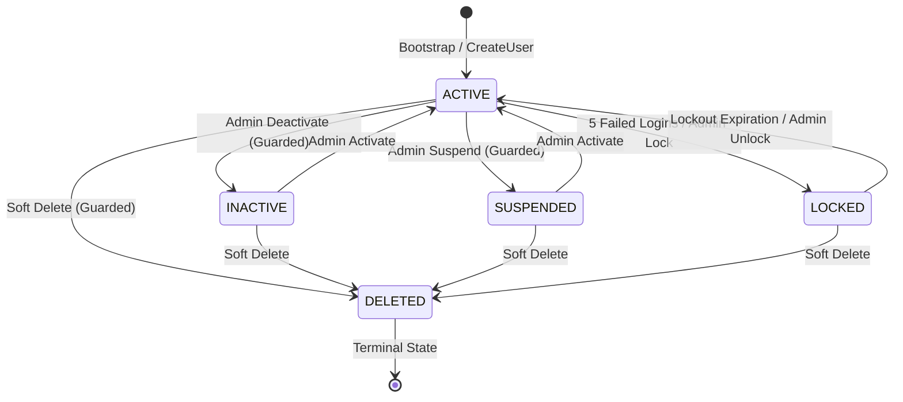
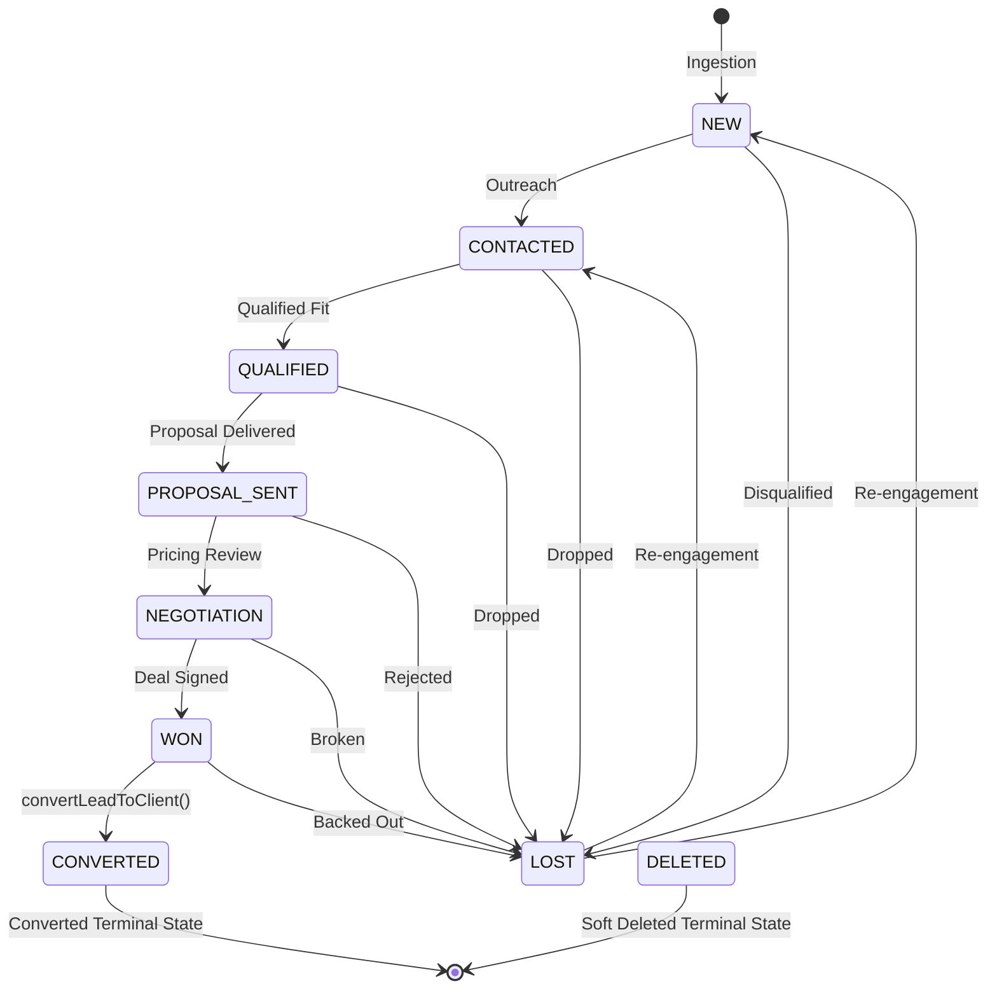
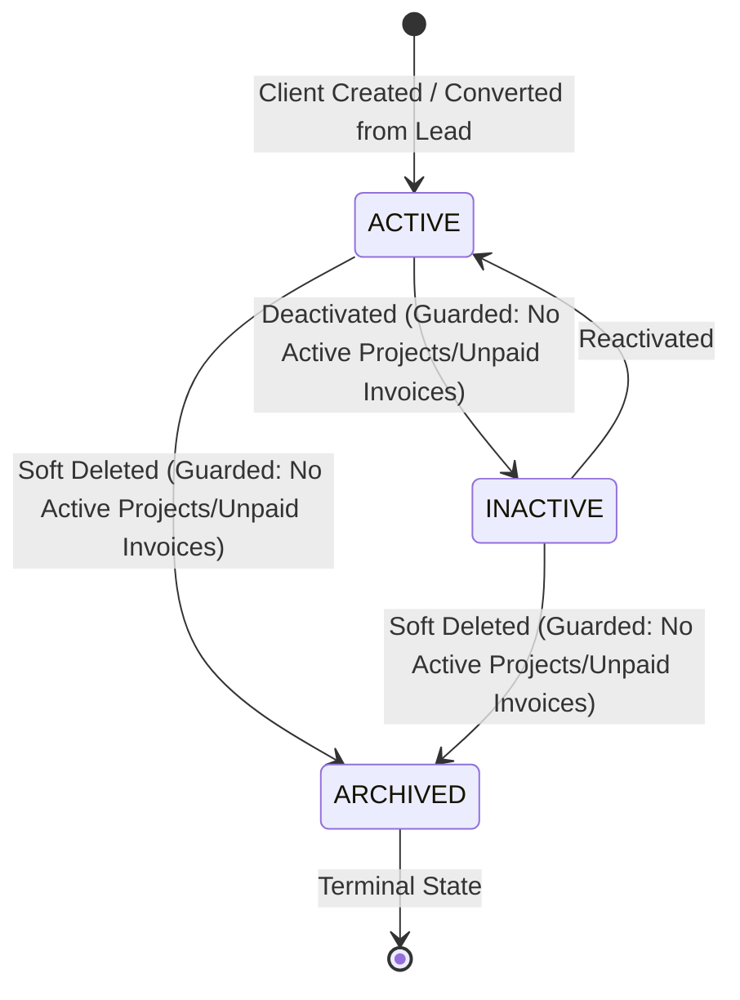
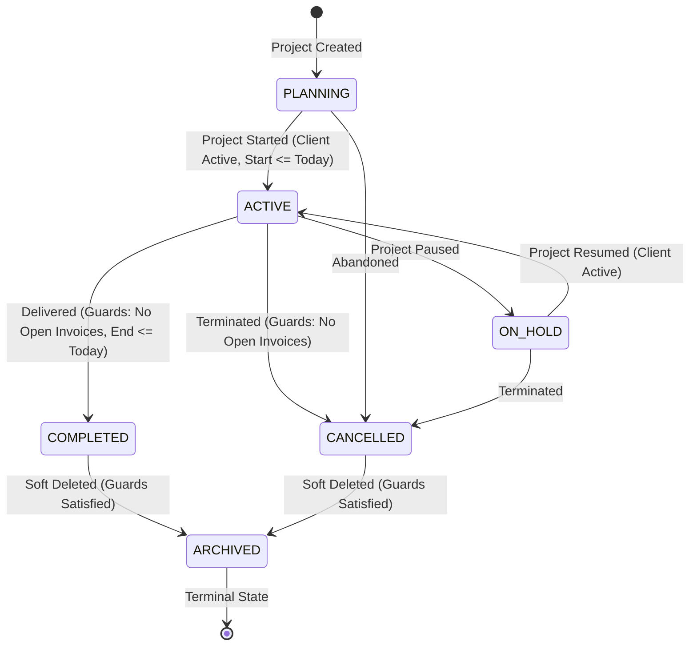
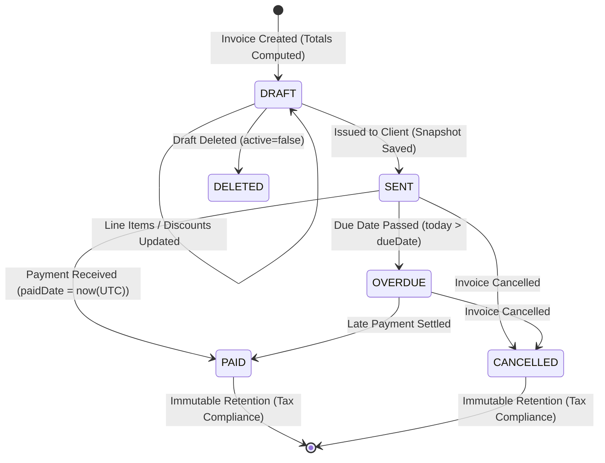

# ELEVATECRM — STATE MACHINE FORENSIC AUDIT

**Repository**: `VirajB9/ElevateCRM-backend`  
**Audit Date**: 2026-11-15  
**Auditor**: Multi-Agent Adversarial Engineering System  

---

## 1. Domain State Machines Overview

ElevateCRM operates five primary entity lifecycles, comprising both explicit state enums and implicit lifecycle invariants:
1. **User Lifecycle & Session State Machine**: `UserStatus` (`ACTIVE`, `INACTIVE`, `SUSPENDED`, `LOCKED`, `DELETED`) + token revocation.
2. **Lead Funnel State Machine**: `LeadStatus` (`NEW`, `CONTACTED`, `QUALIFIED`, `PROPOSAL_SENT`, `NEGOTIATION`, `WON`, `LOST`, `DELETED`, `CONVERTED`).
3. **Client Relationship Lifecycle**: `ClientStatus` (`ACTIVE`, `INACTIVE`, `ARCHIVED`).
4. **Project Delivery State Machine**: `ProjectStatus` (`PLANNING`, `ACTIVE`, `ON_HOLD`, `COMPLETED`, `CANCELLED`, `ARCHIVED`).
5. **Invoice Financial Accounting Lifecycle**: `InvoiceStatus` (`DRAFT`, `SENT`, `PAID`, `OVERDUE`, `CANCELLED`).

---

## 2. In-Depth State Machine Analysis

### 2.1 User Lifecycle & Authentication State Machine

#### Forensic Findings on User State Machine:
1. **Owner Protection Invariant**: The system `OWNER` cannot be deactivated, locked, demoted, or soft-deleted under any condition (enforced in `UserServiceImpl` and self-healed in `OwnerBootstrap`).
2. **Self-Management Guard**: Authenticated users cannot deactivate, modify, or delete their own accounts.
3. **Token Revocation Cascade**: Transitioning to `INACTIVE`, `SUSPENDED`, or `DELETED` immediately purges user refresh tokens and records `tokensRevokedAt = UTC now`.
4. **State Machine Defect Uncovered (Issue #334)**:
   - While `INACTIVE` and `SUSPENDED` invoke `LeadUserDeletionGuard.validateCanDeactivateUser()`, transitioning status to `LOCKED` was excluded from this check.
   - An administrator can set a user to `LOCKED` while they own active leads in the pipeline, stranding leads under an unauthenticated account.
5. **State Revocation Granularity Defect (Issue #338)**:
   - `tokensRevokedAt` is truncated to seconds in `UserServiceImpl` and `AuthServiceImpl`.
   - In `JwtFilter`, `issuedAtSeconds < revokedAtSeconds` uses strict less-than. When a token is issued in the same second that the user state transitions to deactivated/locked/revoked, the token is not rejected and remains active.

---

### 2.2 Lead Funnel & Conversion State Machine

#### Forensic Findings on Lead State Machine:
1. **Linear Progression Invariant**: Status transitions follow a strict linear progression; skipping stages (e.g. `NEW` directly to `WON`) is rejected by `LeadValidator.validateLeadStatus()`.
2. **Re-engagement Pathway**: `LOST` leads are permitted to transition back into `NEW` or `CONTACTED`, resetting active pipeline tracking.
3. **Conversion Terminal State**: Converted leads (`CONVERTED`) are completely immutable; status modification or re-conversion is blocked with `LeadAlreadyConvertedException`.
4. **Authorization Scoping Defect on Unassigned Leads (Issue #339)**:
   - In `LeadValidator.validateLeadAccess()`, the horizontal IDOR guard checks: `if (restrictedUserId != null && lead.getAssignedUserId() != null && !restrictedUserId.equals(lead.getAssignedUserId()))`.
   - When a lead is newly created or unassigned (`lead.getAssignedUserId() == null`), this check evaluates to `false`. Non-managerial employees can mutate, self-claim, convert, or soft-delete unassigned leads directly via ID, violating ownership allocation controls.

---

### 2.3 Client Relationship & Dependency Locks

#### Forensic Findings on Client State Machine:
1. **SPI Deletion Guards**: Archival and deactivation are guarded via `ClientDeletionGuard` SPIs (`ProjectClientDeletionGuard`, `InvoiceClientDeletionGuard`), preventing orphaned projects or unpaid invoices.
2. **Archival Terminal State**: Clients in `ARCHIVED` status cannot be updated or returned in regular search queries.
3. **Cross-Module Invariant Bypass (Issue #337)**:
   - In `ProjectServiceImpl.updateProject()`, `validateClientActiveForProjectUpdate()` is checked ONLY when `request.getStatus() == ProjectStatus.ACTIVE`.
   - An `INACTIVE` client can have projects in `PLANNING` or `ON_HOLD` modified, re-budgeted, or transitioned without triggering client status checks, violating the inactive client operational freeze guarantee.

---

### 2.4 Campaign & Project Delivery State Machine

#### Forensic Findings on Project State Machine:
1. **Immutability of Terminal States**: Projects in `COMPLETED` or `CANCELLED` cannot be edited (`validateProjectEditable`).
2. **Chronological Validity Defect on Partial Update (Issue #335)**:
   - `elevate_crm_complete_architecture_decryption.md` Subsystem 5, Section 4, Item 1 specifies: *"If an update modifies only one date, the cross-field validator fetches the existing record to guarantee chronological integrity."*
   - In implementation, `ProjectValidator.validateProjectDates(request.getStartDate(), request.getEndDate())` checks only the dates present in the request. If an update submits a new `startDate` after the existing `endDate`, chronological integrity is broken.

---

### 2.5 Financial Invoicing State Machine

#### Forensic Findings on Invoice State Machine:
1. **Tax Compliance Retention**: Only `DRAFT` invoices can be deleted; issued, paid, overdue, or cancelled invoices cannot be deleted (`validateInvoiceEditable`).
2. **Status Progression Enforcement**: Drafts cannot transition directly to `PAID` without being `SENT`; paid and cancelled invoices cannot change status.
3. **Misleading Error Context on Cancelled/Archived Projects (Issue #331)**:
   - Updating an existing invoice linked to a cancelled or archived project produces the error `"Cannot create an invoice for a cancelled/archived project"`, misidentifying the operation.
4. **Numeric Scale Defect in Item DTOs (Issue #332)**:
   - Line item `unitPrice`, `discount`, and `taxPercentage` lack `@Digits(fraction = 2)` validation, allowing high-precision scale inputs that degrade mathematical predictability.

---

## 3. Summary of State Machine Defect Logs

| Entity | Defect Description | Invariant Impact | GitHub Issue |
| :--- | :--- | :--- | :--- |
| `User` | User status `LOCKED` bypasses lead deactivation check | Active leads assigned to locked users | [#334](https://github.com/VirajB9/ElevateCRM-backend/issues/334) |
| `User` | Sub-second equality in `JwtFilter` accepts revoked tokens | Post-revocation access token survival | [#338](https://github.com/VirajB9/ElevateCRM-backend/issues/338) |
| `Lead` | Unassigned leads bypass horizontal IDOR scoping | Employees can claim/mutate unassigned prospects | [#339](https://github.com/VirajB9/ElevateCRM-backend/issues/339) |
| `Project` | Partial date update omits existing entity date cross-check | Chronological corruption (`startDate > endDate`) | [#335](https://github.com/VirajB9/ElevateCRM-backend/issues/335) |
| `Project` | `validateClientActiveForProjectUpdate` bypassed for non-ACTIVE | Inactive client projects altered in CRM | [#337](https://github.com/VirajB9/ElevateCRM-backend/issues/337) |
| `Invoice` | Misleading "Cannot create" diagnostics on update | Error context confusion on project cancellation | [#331](https://github.com/VirajB9/ElevateCRM-backend/issues/331) |
| `Invoice` | Unconstrained numeric scale on DTO inputs | Float precision drift & database scale variance | [#332](https://github.com/VirajB9/ElevateCRM-backend/issues/332) |
