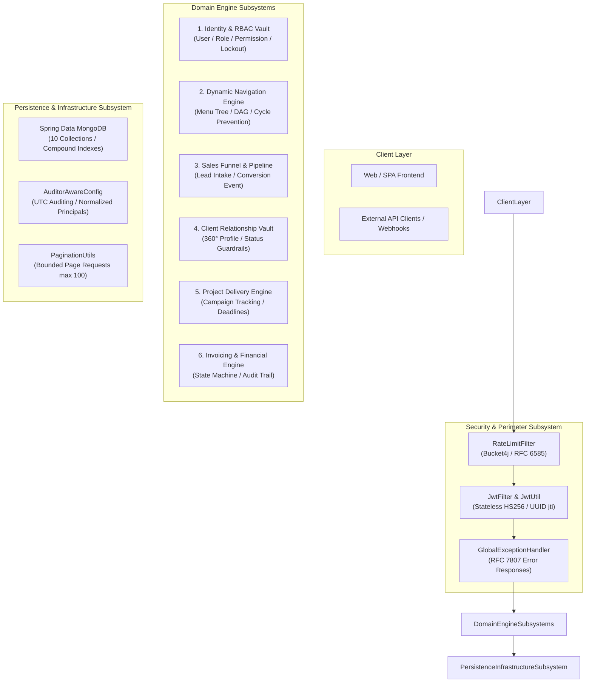
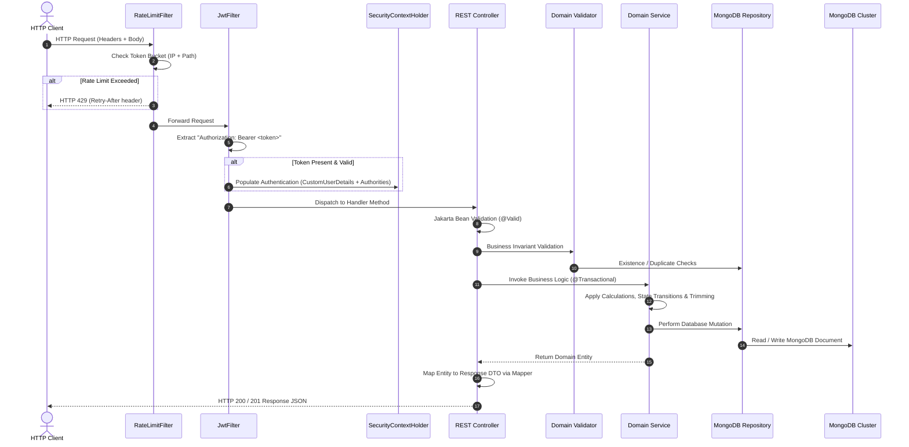
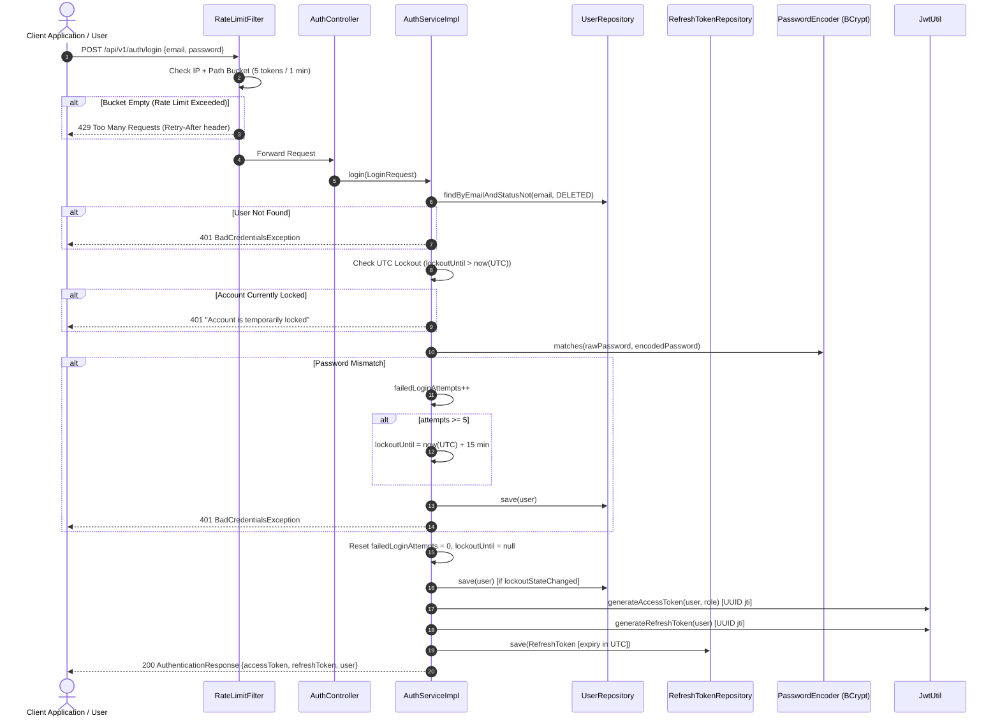
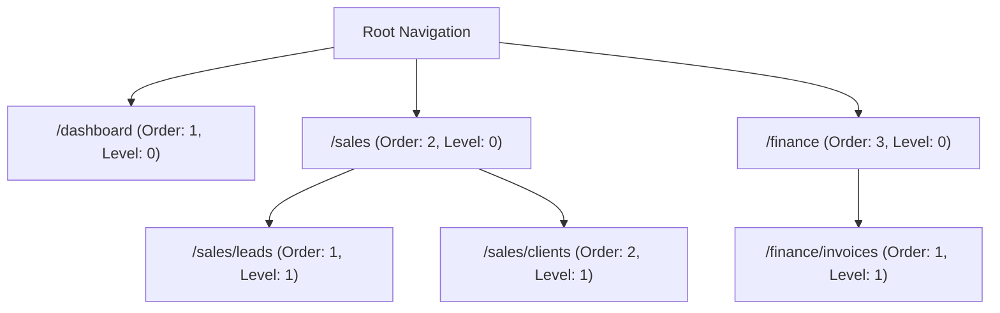
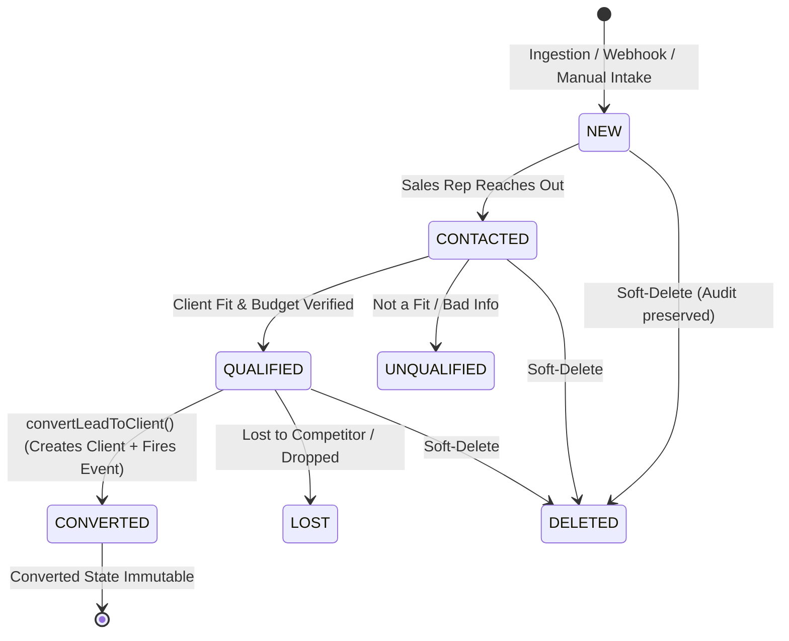
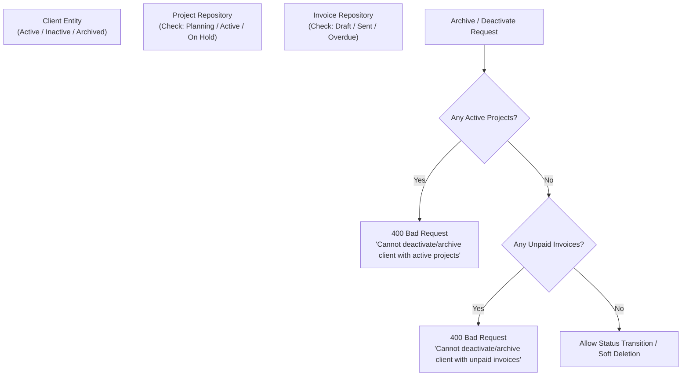
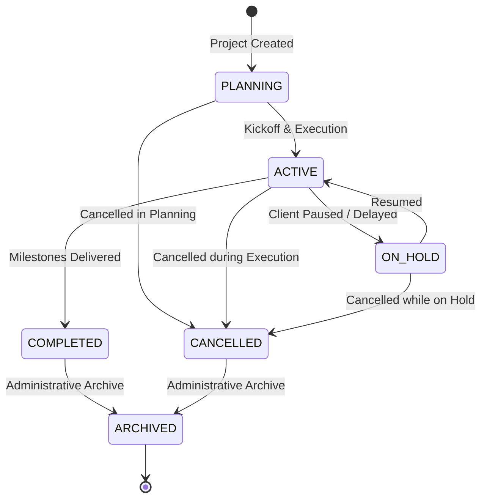
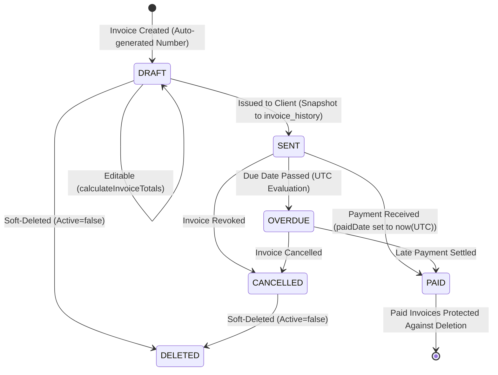
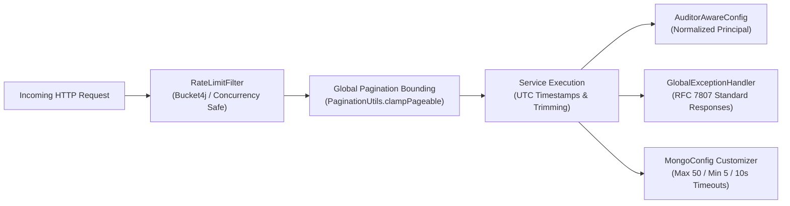

# ElevateCRM (DMA Backend) — Complete System Architecture & Technical Specification

## PURPOSE
This document is the **authoritative architectural blueprint, complete technical decryption, and comprehensive engineering manual** for the ElevateCRM / Digital Marketing Agency (DMA) ERP Backend codebase.
The objective is to enable any software engineer, system architect, or technical stakeholder to understand the entire backend **from zero**, treating the reader with complete conceptual clarity while providing exhaustive, production-grade technical depth across Spring Boot 3.5, Spring Security 6, Spring Data MongoDB, and enterprise ERP domain modeling.

---

### System Health & Operational Benchmarks
- **Automated Test Suite:** **100% test pass rate** across all unit and integration test suites (0 failures, 0 errors, 100% clean build under `./gradlew test --rerun-tasks`).
- **Database Architecture:** **10 dedicated MongoDB collections** (`users`, `roles`, `permissions`, `refresh_tokens`, `menus`, `leads`, `clients`, `projects`, `invoices`, `invoice_history`), governed by declarative compound indexes, unique constraints, and Spring Data auditing.
- **Security & RBAC Enforcement:** Fine-grained Permission-Based Access Control (`module:action`) backed by Spring Security, stateless JWT authentication with unique UUID token IDs (`jti`), rate-limiting buckets with RFC 6585 compliance, brute-force lockout defense with UTC synchronization, and self-healing bootstrap routines.
- **Financial & Accounting Precision:** Strictly normalized 2-decimal-place monetary arithmetic (`RoundingMode.HALF_UP`) across all line items, tax computations, discounts, budgets, and immutable versioned invoice histories.
- **Memory & Query Safety:** Global page size clamping (`MAX_PAGE_SIZE = 100`) via `PaginationUtils` protecting all standard and custom repository queries against heap exhaustion and memory attacks.
- **Production Infrastructure:** Decoupled MongoDB connection pooling and socket timeouts via `MongoClientSettingsBuilderCustomizer` in `MongoConfig`, preventing URI corruption across standalone and replica set clusters.

---

### Architectural Philosophy
1. **Feature-Based Packaging (Domain-Driven Design):** Code is organized strictly by business domain (`auth`, `menu`, `lead`, `client`, `project`, `invoice`), not by horizontal technical layers.
2. **Strict Entity Encapsulation:** MongoDB `@Document` entities are never exposed across HTTP boundaries. All ingress and egress payloads use strictly validated Data Transfer Objects (DTOs) and dedicated mappers.
3. **Defensive Invariant Validation:** Input validation occurs at multiple tiers: Jakarta Bean Validation at the controller boundary, dedicated domain validators (`UserValidator`, `ClientValidator`, `InvoiceValidator`, etc.) in the service layer, and unique database constraints.
4. **Timezone Invariance (UTC Everywhere):** The application relies entirely on `ZoneOffset.UTC` for all dates, token expirations, account lockouts, invoice payments, and lead conversions, eliminating timezone drift bugs.
5. **Idempotent Self-Healing:** Core services and bootstrap runners auto-detect missing, incomplete, or corrupted administrative state and repair it deterministically on startup without requiring manual database interventions.

---

# THE 7 CORE FUNCTIONAL SUBSYSTEMS



1. **Identity, RBAC & Authentication Vault (`auth`):** Multi-tier Role-Based and Permission-Based Access Control (`OWNER`, `MANAGER`, `EMPLOYEE`), stateless JWT authentication, cryptographic password hashing (BCrypt), exponential account lockout, rate limiting, and self-healing bootstrap.
2. **Dynamic Navigation & Hierarchical UI Engine (`menu`):** Self-referential tree data structures, Directed Acyclic Graph (DAG) cycle detection, route path validation, and role-filtered menu projection.
3. **Sales Funnel & Lead Ingestion Pipeline (`lead`):** Top-of-funnel intake, multi-field deduplication (email, phone), ownership assignment, status qualification, and atomic lead-to-client conversion with event broadcasting.
4. **Client Relationship Management & 360-Degree State Vault (`client`):** Canonical enterprise customer entities, GST and corporate profile normalization, soft deletion, and dependency locks preventing deactivation with active projects or unpaid invoices.
5. **Campaign & Project Delivery Engine (`project`):** Deliverable lifecycle tracking, chronological date validation (`startDate <= endDate`), monetary budget normalization, and compound status indexing.
6. **Financial Accounting & Invoicing Engine (`invoice`):** Multi-item invoice lifecycle state machine (`DRAFT -> SENT -> PAID / OVERDUE / CANCELLED`), atomic totals computation, 2-decimal-place monetary rounding, and immutable versioned audit trails (`invoice_history`).
7. **Cross-Cutting Infrastructure, Resilience & Query Safety (`common`, `config`, `exception`):** Bounded pagination (`MAX_PAGE_SIZE = 100`), global exception interception, centralized UTC clock management, and custom full-text regex search.

---

# ==============================================================================
# PART 1 — SYSTEM TOPOLOGY, REQUEST LIFECYCLE & REPOSITORY ARCHITECTURE
# ==============================================================================

### 1. Request Lifecycle & Interception Flow
Every inbound HTTP request traversing the ElevateCRM backend undergoes a strictly sequenced execution pipeline:



---

### 2. The 10 MongoDB Collections & Index Topologies
The database state is governed across 10 collections with declarative compound and unique indexes:

| Collection Name | Primary Key | Key Indexes & Compound Indexes | Purpose |
| :--- | :--- | :--- | :--- |
| **`users`** | `String _id` | `email` (Unique)<br>`phoneNumber` (Sparse Unique)<br>`(roleId, status)` (Compound) | Internal agency staff credentials, lockout states, and role assignments. |
| **`roles`** | `String _id` | `name` (Unique) | Predefined and custom RBAC roles (`ROLE_OWNER`, `ROLE_MANAGER`, `ROLE_EMPLOYEE`). |
| **`permissions`** | `String _id` | `permissionType` (Unique) | System capabilities mapped by `module:action`. |
| **`refresh_tokens`** | `String _id` | `token` (Unique)<br>`userId` (Indexed)<br>`expiryDate` (Indexed) | Persisted refresh token vault with UTC expirations. |
| **`menus`** | `String _id` | `title` (Unique)<br>`path` (Unique)<br>`parentId` (Indexed) | Navigation tree nodes with parent-child hierarchical references. |
| **`leads`** | `String _id` | `email` (Unique)<br>`phoneNumber` (Unique)<br>`(assignedUserId, status)` (Compound)<br>`(source, status)` (Compound) | Sales prospects undergoing qualification before conversion. |
| **`clients`** | `String _id` | `email` (Unique)<br>`phoneNumber` (Unique)<br>`gstNumber` (Sparse Unique)<br>`status` (Indexed) | Paying customer accounts and corporate profiles. |
| **`projects`** | `String _id` | `(name, clientId)` (Unique)<br>`(clientId, status)` (Compound)<br>`status` (Indexed) | Active agency deliverables, deadlines, and campaign budgets. |
| **`invoices`** | `String _id` | `invoiceNumber` (Unique)<br>`clientId` (Indexed)<br>`projectId` (Indexed)<br>`status` (Indexed) | Financial bills, line items, taxes, discounts, and payment tracking. |
| **`invoice_history`** | `String _id` | `(invoiceId, invoiceVersion)` (Compound Ascending) | Immutable append-only audit snapshots of every invoice modification. |

---

### 3. Entity Inheritance & Spring Data Auditing
All core domain models inherit from the common `BaseEntity` abstraction:

```java
@Getter
@Setter
public abstract class BaseEntity {

    @CreatedDate
    private LocalDateTime createdAt;

    @LastModifiedDate
    private LocalDateTime updatedAt;

    @CreatedBy
    private String createdBy;

    @LastModifiedBy
    private String updatedBy;
}
```
- **Automatic UTC Timestamps:** Populated via Spring Data MongoDB's `@EnableMongoAuditing`.
- **Sanitized Auditor Principal:** `AuditorAwareConfig` extracts the authenticated user, automatically trimming whitespace and lowercasing email strings so audit logs remain clean and consistent.

---

# PART 2 — SUBSYSTEM 1: IDENTITY, RBAC & AUTHENTICATION VAULT (`auth`)



### 1. Identity & Mission
The **Identity, RBAC & Authentication Vault** is the security foundation of ElevateCRM. It manages user credentials, enforces role hierarchies (`OWNER` > `MANAGER` > `EMPLOYEE`), evaluates fine-grained permissions, dispenses stateless cryptographic tokens, and protects the ERP against brute-force intrusion, credential stuffing, and unauthorized vertical or horizontal privilege escalation.

---

### 2. The Subsystem in ONE Sentence
> **This subsystem verifies who you are, what you are permitted to do, issues digitally signed time-limited passports (JWTs) with unique tracking IDs, and locks you out if you repeatedly attempt to guess passwords.**

---

### 3. The Subsystem in 5-Year-Old Language
Imagine you live in a treehouse club with a secret password at the front gate. If you know the password, the gatekeeper hands you a golden wristband with a timer on it. The wristband tells everyone if you are the Club President, a Room Captain, or a Member. If a stranger shows up and guesses the password wrong 5 times in a row, the gatekeeper puts a padlock on the gate for 15 minutes and refuses to talk to them.

---

### 4. Core Security Design Guarantees
1. **Stateless JWT with Unique Traceability:** Every access and refresh token contains an RFC 7519 `jti` claim populated with a cryptographically secure UUID (`UUID.randomUUID().toString()`), enabling individual token auditing in distributed systems.
2. **Deterministic UTC Lockout Evaluation:** Failed login attempts increment an internal counter. Upon the 5th consecutive failure, `lockoutUntil` is set to `LocalDateTime.now(ZoneOffset.UTC).plusMinutes(15)`. Both `CustomUserDetails.isAccountNonLocked()` and `AuthServiceImpl` evaluate lockouts strictly against `ZoneOffset.UTC`.
3. **Lockout Persistence & Auto-Clearing:** When an expired lockout is followed by a successful login, the system clears `lockoutUntil` and resets `failedLoginAttempts = 0`, persisting the updated user state to MongoDB immediately.
4. **Mandatory Password Change Lifecycle:** When a user is provisioned with `passwordChangeRequired = true`, `JwtFilter` restricts API access exclusively to `POST /api/v1/auth/change-password` and `POST /api/v1/auth/refresh`. This ensures that if the short-lived access token expires before the password is changed, the client can refresh their token without being locked out.
5. **Self-Healing Owner Bootstrap:** On application startup, `OwnerBootstrap` verifies that the system Owner account not only exists, but that its `roleId` matches `ROLE_OWNER` and its status is `ACTIVE`. If an accidental database modification alters this, the bootstrap runner self-heals the administrative account automatically.

---

### 5. Document Schemas & Index Strategy

#### The `users` Collection
```json
{
  "_id": "673f8a9e1b2c3d4e5f6a7b8c",
  "firstName": "Viraj",
  "lastName": "Bhalla",
  "email": "owner@agency.com",
  "password": "$2a$10$e7mZ9rN8P9vKq...",
  "phoneNumber": "9876543210",
  "roleId": "673f8a9e1b2c3d4e5f6a7b8d",
  "status": "ACTIVE",
  "failedLoginAttempts": 0,
  "lockoutUntil": null,
  "passwordChangeRequired": false,
  "createdAt": "2026-11-06T10:00:00Z",
  "updatedAt": "2026-11-06T10:00:00Z"
}
```
**Indexes Enforced:**
- `{"email": 1}` — Unique index on normalized email.
- `{"phoneNumber": 1}` — Sparse unique index on mobile number.
- `{"roleId": 1, "status": 1}` — Compound index optimizing role member queries and filtering.

#### The `roles` & `permissions` Collections
- `roles`: Stores `name` (Unique index) and a `Set<String> permissionIds`. Predefined roles: `ROLE_OWNER`, `ROLE_MANAGER`, `ROLE_EMPLOYEE`.
- `permissions`: Stores `permissionType` (Unique index), `module`, and `description`.


---

# PART 3 — SUBSYSTEM 2: DYNAMIC NAVIGATION & HIERARCHICAL UI ENGINE (`menu`)



### 1. Identity & Mission
The **Dynamic Navigation & Hierarchical UI Engine** produces role-filtered, nested menu structures (trees) consumed by modern Single-Page Applications (React/Vue/Angular). It prevents circular parent-child loops, enforces strict URL path normalization, validates menu depth, and projects real-time UI routes according to user permissions.

---

### 2. The Subsystem in ONE Sentence
> **This subsystem builds the sidebar and top navigation menu trees for the frontend, ensuring that parents cannot become their own grandparents and users only see buttons they have permission to click.**

---

### 3. The Subsystem in 5-Year-Old Language
Imagine you have a stack of nesting boxes. The big box holds medium boxes, and medium boxes hold tiny boxes. If you try to put the big box inside the tiny box, the laws of physics break! This module makes sure every box stays in the right order and stops anyone from trying to put a big box inside itself.

---

### 4. Core Architectural & Resiliency Guarantees
1. **DAG Cycle Detection:** The engine guarantees that navigation menus form a Directed Acyclic Graph. When setting or updating `parentId`, it traverses up the hierarchy to guarantee a menu never becomes an ancestor of itself.
2. **Canonical Route Normalization:** Paths are strictly validated: they must begin with `/`, cannot contain duplicate slashes (`//`), and must omit trailing slashes (`/menu/` is rejected; `/menu` is required) to ensure 100% deterministic route matching on client-side routers.
3. **Deactivation Cascade Safety:** A parent menu cannot be deactivated while it has active child submenus. Administrators must explicitly deactivate or reassign child nodes first.
4. **Update Uniqueness Independence:** Duplicate title and path checks during update operations explicitly exclude the record being updated using normalized identifier matching, preventing false self-collision errors.

---

### 5. Algorithmic Cycle Detection Protocol
When updating a menu item's hierarchy, the engine verifies the parent chain using an in-memory visited set:

```java
public void validateParentRelationship(String menuId, String parentId) {
    if (menuId == null || parentId == null || parentId.isBlank()) {
        return;
    }
    String trimmedMenuId = menuId.trim();
    String trimmedParentId = parentId.trim();

    if (trimmedMenuId.equals(trimmedParentId)) {
        throw new SelfParentMenuException("A menu item cannot be its own parent.");
    }

    String currentParent = trimmedParentId;
    Set<String> visited = new HashSet<>();

    while (currentParent != null) {
        if (currentParent.equals(trimmedMenuId)) {
            throw new CircularMenuException("Circular menu relationship detected.");
        }
        if (!visited.add(currentParent)) {
            break; // Terminate if cycle exists elsewhere in disconnected graph
        }
        Menu parent = menuRepository.findById(currentParent).orElse(null);
        currentParent = parent != null ? parent.getParentId() : null;
    }
}
```

---

# PART 4 — SUBSYSTEM 3: SALES FUNNEL & LEAD INGESTION PIPELINE (`lead`)



### 1. Identity & Mission
The **Sales Funnel & Lead Ingestion Pipeline** drives the acquisition lifecycle of prospective customers. It enforces strict deduplication on contact channels (email, phone), normalizes monetary budget approximations to 2 decimal places, manages sales representative assignments, and provides an atomic transition from prospective lead to full enterprise client.

---

### 2. The Subsystem in ONE Sentence
> **This subsystem captures incoming sales prospects, ensures no sales reps are fighting over duplicate leads, and cleanly converts successful prospects into verified clients while firing downstream integration events.**

---

### 3. The Subsystem in 5-Year-Old Language
Imagine someone walking into a lemonade stand saying they might want to buy 100 cups tomorrow. You write their name and phone number in your notebook under "Interested People". If another kid tries to write the same person's name down, you stop them because you already wrote it. When they actually hand you the money and sign up, you take their name out of "Interested People" and put them into your VIP Customer Book.

---

### 4. Core Architectural & Resiliency Guarantees
1. **Multi-Field Deduplication:** Incoming leads are checked across normalized email (`trim().toLowerCase()`) and normalized phone numbers (`trim()`) against all non-deleted records.
2. **Monetary Precision Normalization:** All `estimatedBudget` values are coerced to 2 decimal places using `RoundingMode.HALF_UP` upon ingestion and update, preventing precision drift.
3. **Compound Status Queries:** High-velocity queries for sales reps and marketing sources leverage compound indexes `(assignedUserId, status)` and `(source, status)`.
4. **Assigned Rep Integrity:** Soft-deleting a sales representative (`UserStatus.DELETED`) is blocked if that user currently owns active leads, preventing orphaned prospects.
5. **Atomic Lead-to-Client Conversion with Enriched Event:** During `convertLeadToClient`, the new `Client` is persisted first, the lead is updated with `convertedClientId` and `convertedAt (UTC)`, and the `LeadConvertedEvent` is published carrying both `leadId` and the newly minted `clientId` for downstream consumers.

---

### 5. The Atomic Lead-to-Client Conversion Protocol

```java
@Transactional
@Override
public LeadResponse convertLeadToClient(String leadId) {
    String trimmedLeadId = leadId != null ? leadId.trim() : null;
    Lead lead = findLeadById(trimmedLeadId);

    leadValidator.validateLeadConversion(lead);

    LeadConversionData data = LeadConversionData.builder()
            .leadId(lead.getId())
            .firstName(lead.getFirstName())
            .lastName(lead.getLastName())
            .companyName(lead.getCompanyName())
            .email(lead.getEmail())
            .phoneNumber(lead.getPhoneNumber())
            .website(lead.getWebsite())
            .industry(lead.getIndustry())
            .notes(lead.getNotes())
            .build();

    // 1. Create the Client entity
    Client client = clientService.createClientFromLead(data);

    // 2. Mark the lead as converted with UTC timestamp
    lead.setStatus(LeadStatus.CONVERTED);
    lead.setConvertedClientId(client.getId());
    lead.setConvertedAt(LocalDateTime.now(ZoneOffset.UTC));

    Lead savedLead = leadRepository.save(lead);

    // 3. Construct event payload WITH the newly created clientId
    LeadConversionData eventData = data.toBuilder()
            .clientId(client.getId())
            .build();

    // 4. Publish integration event
    eventPublisher.publishEvent(new LeadConvertedEvent(eventData));

    return leadMapper.toLeadResponse(savedLead);
}
```

---

# PART 5 — SUBSYSTEM 4: CLIENT RELATIONSHIP MANAGEMENT & 360-DEGREE STATE VAULT (`client`)



### 1. Identity & Mission
The **Client Relationship Management & 360-Degree State Vault** is the single source of truth for all paying corporate accounts. It enforces rigorous business rules preventing the accidental archiving or deactivation of clients that currently have ongoing client projects or unpaid financial invoices.

---

### 2. The Subsystem in ONE Sentence
> **This subsystem stores corporate client profiles, enforces Indian Goods & Services Tax (GST) number formatting, and locks clients against deactivation if they owe money or have live projects.**

---

### 3. The Subsystem in 5-Year-Old Language
Imagine you run a toy repair shop. If someone drops off their favorite toy for you to fix, or if they haven't paid you for fixing their previous toy, you cannot cross their name out of your address book and throw it in the trash. You must finish fixing their toy and make sure all bills are settled before closing their account!

---

### 4. Core Architectural & Resiliency Guarantees
1. **Multi-Module Relationship Guardrails:** A client cannot be transitioned to `INACTIVE` or `ARCHIVED` if they are linked to projects in `PLANNING`, `ACTIVE`, or `ON_HOLD` status, or active invoices in `DRAFT`, `SENT`, or `OVERDUE` status.
2. **Indian GST Normalization:** GST identification numbers are trimmed, converted to uppercase, and validated against standard 15-character statutory alphanumeric formatting (`^[0-9]{2}[A-Z]{5}[0-9]{4}[A-Z]{1}[1-9A-Z]{1}Z[0-9A-Z]{1}$`).
3. **Whitespaces & Notes Sanitization:** Multiline notes and profile contact strings are stripped of excessive whitespace and normalized across creation, updates, and lead conversion pipelines.


---

# PART 6 — SUBSYSTEM 5: CAMPAIGN & PROJECT DELIVERY ENGINE (`project`)



### 1. Identity & Mission
The **Campaign & Project Delivery Engine** schedules and oversees digital marketing campaigns (SEO, Performance Marketing, Social Media, Content Production) associated with clients. It enforces chronological scheduling constraints, normalizes financial budget scales, and maintains high-throughput compound lookups for client dashboard projections.

---

### 2. The Subsystem in ONE Sentence
> **This subsystem tracks deadlines, schedules, milestones, and budgets for agency deliverables while ensuring that start dates never happen after end dates.**

---

### 3. The Subsystem in 5-Year-Old Language
Imagine you have a calendar where you plan out building a big Lego tower. You write down the day you start and the day you finish. You can't say you will finish building the tower yesterday and start building it tomorrow! This module makes sure your calendar dates make sense and keeps track of how much your project costs.

---

### 4. Core Architectural & Resiliency Guarantees
1. **Chronological Validity:** Start dates and end dates are strictly validated such that `startDate <= endDate`. If an update modifies only one date, the cross-field validator fetches the existing record to guarantee chronological integrity.
2. **Monetary Budget Normalization:** All project budgets are normalized to 2 decimal places using `RoundingMode.HALF_UP` on create and update operations, eliminating precision mismatches.
3. **Compound Retrieval Optimization:** Retrieval of active projects by client leverages the compound index `{"clientId": 1, "status": 1}`, allowing sub-millisecond query execution on client dashboards.
4. **Editable State Constraints:** Only projects in `PLANNING`, `ACTIVE`, or `ON_HOLD` can be updated. Completed or archived projects are immutable.

---

# PART 7 — SUBSYSTEM 6: FINANCIAL ACCOUNTING & INVOICING ENGINE (`invoice`)



### 1. Identity & Mission
The **Financial Accounting & Invoicing Engine** is the monetary backbone of ElevateCRM. It manages invoice lifecycle state transitions, calculates multi-item monetary breakdowns, enforces tax percentages and discounts with bank-grade decimal precision (`RoundingMode.HALF_UP`), preserves immutable audit snapshots in `invoice_history`, and protects issued invoices against deletion.

---

### 2. The Subsystem in ONE Sentence
> **This subsystem calculates invoice items, applies discounts and taxes with exact two-decimal penny precision, protects paid bills from tampering, and keeps an unalterable history of every invoice version.**

---

### 3. The Subsystem in 5-Year-Old Language
Imagine you write a receipt for selling cookies. You write down 2 cookies for 5 dollars each, which makes 10 dollars. If you give a 1-dollar discount, it's 9 dollars. Then you add the government cookie tax. Once you give this receipt to the customer or they pay you, you can't tear it up or change the numbers! You keep a copy in a locked safe forever.

---

### 4. Mathematical Precision & Totals Calculation Formula
Every invoice computation strictly adheres to the following mathematical specification, ensuring zero floating-point drift:

$$\text{LineTotal}_i = \text{round}_{2, \text{HALF\_UP}}(\text{Quantity}_i \times \text{UnitPrice}_i)$$

$$\text{Subtotal} = \sum_{i=1}^{N} \text{LineTotal}_i$$

$$\text{TaxableAmount} = \max\left(0.00, \; \text{round}_{2, \text{HALF\_UP}}(\text{Subtotal} - \text{Discount})\right)$$

$$\text{TaxAmount} = \text{round}_{2, \text{HALF\_UP}}\left(\frac{\text{TaxableAmount} \times \text{TaxPercentage}}{100.00}\right)$$

$$\text{TotalAmount} = \text{round}_{2, \text{HALF\_UP}}(\text{TaxableAmount} + \text{TaxAmount})$$

#### Production Implementation in `InvoiceServiceImpl.java`
```java
void calculateInvoiceTotals(Invoice invoice) {
    BigDecimal subtotal = BigDecimal.ZERO;

    if (invoice.getItems() != null) {
        for (InvoiceItem item : invoice.getItems()) {
            if (item == null) continue;

            BigDecimal quantity = Optional.ofNullable(item.getQuantity())
                    .orElse(BigDecimal.ZERO);

            // Unit price normalized to 2 decimal places
            BigDecimal unitPrice = Optional.ofNullable(item.getUnitPrice())
                    .orElse(BigDecimal.ZERO)
                    .setScale(2, RoundingMode.HALF_UP);
            item.setUnitPrice(unitPrice);

            BigDecimal lineTotal = quantity.multiply(unitPrice)
                    .setScale(2, RoundingMode.HALF_UP);
            item.setLineTotal(lineTotal);

            subtotal = subtotal.add(lineTotal);
        }
    }

    subtotal = subtotal.setScale(2, RoundingMode.HALF_UP);

    // Tax percentage normalized to 2 decimal places
    BigDecimal taxPercentage = Optional.ofNullable(invoice.getTaxPercentage())
            .orElse(BigDecimal.ZERO)
            .setScale(2, RoundingMode.HALF_UP);
    invoice.setTaxPercentage(taxPercentage);

    BigDecimal discount = Optional.ofNullable(invoice.getDiscount())
            .orElse(BigDecimal.ZERO)
            .setScale(2, RoundingMode.HALF_UP);

    BigDecimal taxableAmount = subtotal.subtract(discount)
            .max(BigDecimal.ZERO)
            .setScale(2, RoundingMode.HALF_UP);

    BigDecimal taxAmount = taxableAmount.multiply(taxPercentage)
            .divide(BigDecimal.valueOf(100), 2, RoundingMode.HALF_UP);

    BigDecimal totalAmount = taxableAmount.add(taxAmount)
            .setScale(2, RoundingMode.HALF_UP);

    invoice.setSubtotal(subtotal);
    invoice.setTaxAmount(taxAmount);
    invoice.setDiscount(discount);
    invoice.setTotalAmount(totalAmount);
}
```

---

### 5. Immutable Versioned Audit Trail (`invoice_history`)
Whenever an invoice is created, updated, status-transitioned, or cancelled, the service persists an immutable audit snapshot in the `invoice_history` collection:
- **Snapshotted Fields:** `invoiceId`, `invoiceVersion`, `invoiceNumber`, items snapshot, `subtotal`, `discount`, `taxPercentage`, `taxAmount`, `totalAmount`, `status`, `notes`, `changedAt` (UTC), `changedBy`.
- **Audit Ordering Index:** `{"invoiceId": 1, "invoiceVersion": 1}` ensures sequential version retrieval.
- **Deletion Protection:** Invoices in `SENT`, `PAID`, or `OVERDUE` status cannot be deleted. Soft deletion is restricted to `DRAFT` or `CANCELLED` invoices only.

---

# PART 8 — SUBSYSTEM 7: CROSS-CUTTING INFRASTRUCTURE, RESILIENCE & QUERY SAFETY



### 1. Identity & Mission
The **Cross-Cutting Infrastructure Subsystem** enforces global invariants across all business modules: bounding pagination to prevent denial-of-service memory exhaustion, rate limiting abusive clients with standard RFC 6585 headers, sanitizing audit log principals, and standardizing all error responses under RFC 7807 specifications.

---

### 2. Global Pagination Bounding Protocol (`PaginationUtils`)
Without defensive bounding, an API client can request `?page=0&size=1000000`, forcing Spring Data MongoDB to load millions of documents into JVM heap memory, causing immediate OutOfMemory (OOM) crashes.

```java
public final class PaginationUtils {
    public static final int MAX_PAGE_SIZE = 100;

    private PaginationUtils() {}

    public static Pageable clampPageable(Pageable pageable) {
        if (pageable == null || pageable.isUnpaged()) {
            return PageRequest.of(0, MAX_PAGE_SIZE);
        }
        if (pageable.getPageSize() > MAX_PAGE_SIZE) {
            return PageRequest.of(pageable.getPageNumber(), MAX_PAGE_SIZE, pageable.getSort());
        }
        return pageable;
    }
}
```
**Applied Consistently:**
Invoked in `UserServiceImpl`, `ClientServiceImpl`, `LeadServiceImpl`, `ProjectServiceImpl`, `InvoiceServiceImpl`, `RoleServiceImpl`, and all custom text-search repositories.

---

### 3. Concurrency-Safe Rate Limiting with RFC 6585 Compliance (`RateLimitFilter`)
To protect authentication endpoints against brute-force attacks and credential stuffing, `RateLimitFilter` manages in-memory token buckets per endpoint and IP address:

```java
// Separate buckets per path and IP
String bucketKey = path + ":" + clientIp;
Bucket bucket = buckets.computeIfAbsent(bucketKey, k -> createNewBucket());

ConsumptionProbe probe = bucket.tryConsumeAndReturnRemaining(1);
if (probe.isConsumed()) {
    filterChain.doFilter(request, response);
} else {
    // RFC 6585 Standard Header
    long waitForRefillSeconds = Math.max(1, TimeUnit.NANOSECONDS.toSeconds(probe.getNanosToWaitForRefill()));
    response.setStatus(429);
    response.setHeader("Retry-After", String.valueOf(waitForRefillSeconds));
    response.setContentType(MediaType.APPLICATION_JSON_VALUE);
    response.getWriter().write(errorMessageJson);
}
```

#### Cache Eviction Safety
Under heavy multi-threaded loads, cache eviction uses a thread-safe double-checked locking mechanism to prevent cache thrashing or resource leaks:
```java
if (buckets.size() > MAX_CACHE_SIZE) {
    synchronized (evictionLock) {
        if (buckets.size() > MAX_CACHE_SIZE) {
            buckets.entrySet().removeIf(entry -> entry.getValue().getAvailableTokens() == CAPACITY);
        }
    }
}
```

---

### 4. Principal Normalization & Auditing (`AuditorAwareConfig`)
Spring Data MongoDB automatically populates `@CreatedBy` and `@LastModifiedBy` audit fields on all documents inheriting from `BaseEntity`. `AuditorAwareConfig` ensures that audit signatures are never tainted with surrounding whitespace or inconsistent casing:

```java
if (principal instanceof UserDetails userDetails) {
    return Optional.ofNullable(userDetails.getUsername())
            .map(String::trim)
            .map(String::toLowerCase)
            .filter(username -> !username.isBlank());
} else if (principal instanceof String email) {
    return Optional.of(email)
            .map(String::trim)
            .map(String::toLowerCase)
            .filter(value -> !value.isBlank());
}
```

---

### 5. Production MongoDB Connection Pooling (`MongoConfig`)
In production environments (`application-prod.yml`), connection pooling and socket timeouts are managed cleanly via Spring Boot's type-safe customizer:

```java
@Configuration
@EnableMongoAuditing(auditorAwareRef = "auditorAware")
public class MongoConfig {

    @Bean
    public MongoTransactionManager transactionManager(MongoDatabaseFactory dbFactory) {
        return new MongoTransactionManager(dbFactory);
    }

    @Bean
    @Profile("prod")
    public MongoClientSettingsBuilderCustomizer mongoConnectionCustomizer() {
        return clientSettingsBuilder -> clientSettingsBuilder
                .applyToConnectionPoolSettings(pool -> pool.maxSize(50).minSize(5))
                .applyToSocketSettings(socket -> socket
                        .connectTimeout(10000, TimeUnit.MILLISECONDS)
                        .readTimeout(10000, TimeUnit.MILLISECONDS));
    }
}
```

---

# PART 9 — THE FULL PERMISSION & SECURITY ACCESS MATRIX

ElevateCRM enforces granular permissions defined in the `PermissionType` enum. Capabilities are granted to roles during system bootstrap and evaluated via Spring Security `@PreAuthorize("hasAuthority('...')")`:

| Module | Permission Type | HTTP Endpoints Protected | Minimum Allowed Role |
| :--- | :--- | :--- | :--- |
| **USER** | `USER_CREATE` | `POST /api/v1/users` | `ROLE_OWNER` |
| **USER** | `USER_READ` | `GET /api/v1/users/**` | `ROLE_MANAGER` |
| **USER** | `USER_UPDATE` | `PUT /api/v1/users/{id}`, `PATCH /api/v1/users/{id}/status` | `ROLE_OWNER` |
| **USER** | `USER_DELETE` | `DELETE /api/v1/users/{id}` | `ROLE_OWNER` |
| **ROLE** | `ROLE_READ` | `GET /api/v1/roles/**` | `ROLE_MANAGER` |
| **ROLE** | `ROLE_UPDATE` | `PUT /api/v1/roles/{id}`, `POST /api/v1/roles/{id}/permissions` | `ROLE_OWNER` |
| **MENU** | `MENU_CREATE` | `POST /api/v1/menus` | `ROLE_OWNER` |
| **MENU** | `MENU_READ` | `GET /api/v1/menus/**` | `ROLE_EMPLOYEE` |
| **MENU** | `MENU_UPDATE` | `PUT /api/v1/menus/{id}` | `ROLE_OWNER` |
| **MENU** | `MENU_DELETE` | `DELETE /api/v1/menus/{id}` | `ROLE_OWNER` |
| **LEAD** | `LEAD_CREATE` | `POST /api/v1/leads` | `ROLE_EMPLOYEE` |
| **LEAD** | `LEAD_READ` | `GET /api/v1/leads/**` | `ROLE_EMPLOYEE` |
| **LEAD** | `LEAD_UPDATE` | `PUT /api/v1/leads/{id}`, `POST /api/v1/leads/{id}/convert` | `ROLE_MANAGER` |
| **LEAD** | `LEAD_DELETE` | `DELETE /api/v1/leads/{id}` | `ROLE_MANAGER` |
| **CLIENT** | `CLIENT_CREATE`| `POST /api/v1/clients` | `ROLE_MANAGER` |
| **CLIENT** | `CLIENT_READ` | `GET /api/v1/clients/**` | `ROLE_EMPLOYEE` |
| **CLIENT** | `CLIENT_UPDATE`| `PUT /api/v1/clients/{id}` | `ROLE_MANAGER` |
| **CLIENT** | `CLIENT_DELETE`| `DELETE /api/v1/clients/{id}` | `ROLE_OWNER` |
| **PROJECT**| `PROJECT_CREATE`| `POST /api/v1/projects` | `ROLE_MANAGER` |
| **PROJECT**| `PROJECT_READ` | `GET /api/v1/projects/**` | `ROLE_EMPLOYEE` |
| **PROJECT**| `PROJECT_UPDATE`| `PUT /api/v1/projects/{id}` | `ROLE_MANAGER` |
| **PROJECT**| `PROJECT_DELETE`| `DELETE /api/v1/projects/{id}` | `ROLE_OWNER` |
| **INVOICE**| `INVOICE_CREATE`| `POST /api/v1/invoices` | `ROLE_MANAGER` |
| **INVOICE**| `INVOICE_READ` | `GET /api/v1/invoices/**` | `ROLE_EMPLOYEE` |
| **INVOICE**| `INVOICE_UPDATE`| `PUT /api/v1/invoices/{id}`, `PATCH /api/v1/invoices/{id}/status`| `ROLE_MANAGER` |
| **INVOICE**| `INVOICE_DELETE`| `DELETE /api/v1/invoices/{id}` | `ROLE_OWNER` |

---

# PART 10 — SYSTEM BOOTSTRAP, OPERATIONAL RUNBOOK & DEVELOPER PROTOCOL

```mermaid
sequenceDiagram
    autonumber
    participant App as Spring Boot Application Startup
    participant PBoot as PermissionBootstrap (Order: 1)
    participant RBoot as RoleBootstrap (Order: 2)
    participant OBoot as OwnerBootstrap (Order: 3)
    participant MBoot as MenuBootstrap (Order: 4)
    participant DB as MongoDB Collections

    App->>PBoot: Run (CommandLineRunner)
    PBoot->>DB: Scan PermissionType enum; insert missing permissions
    App->>RBoot: Run (CommandLineRunner)
    RBoot->>DB: Ensure ROLE_OWNER, ROLE_MANAGER, ROLE_EMPLOYEE exist
    RBoot->>DB: Link all permissions to ROLE_OWNER
    App->>OBoot: Run (CommandLineRunner)
    OBoot->>DB: Check Owner exists by email (OWNER_EMAIL)
    alt Owner Does Not Exist
        OBoot->>DB: Create Owner (ACTIVE, BCrypt initial password, ROLE_OWNER)
    else Owner Exists (Self-Healing Branch)
        OBoot->>OBoot: Verify roleId == ROLE_OWNER && status == ACTIVE
        OBoot->>DB: Save healed Owner account if corrupted
    end
    App->>MBoot: Run (CommandLineRunner)
    MBoot->>DB: Seed initial navigation hierarchy (Dashboard, Sales, Finance, Settings)
```

### 1. The 4-Stage Ordered Bootstrap Sequence
The system initializes deterministically on every container startup using Spring `CommandLineRunner` beans:
1. **`PermissionBootstrap`:** Iterates across all `PermissionType` enum constants, extracting their prefix as the `module` name, and idempotently inserts them into the `permissions` collection.
2. **`RoleBootstrap`:** Ensures the system roles exist (`ROLE_OWNER`, `ROLE_MANAGER`, `ROLE_EMPLOYEE`). Automatically associates 100% of defined permissions with `ROLE_OWNER`.
3. **`OwnerBootstrap`:** Inspects environment variables `OWNER_EMAIL` and `OWNER_INITIAL_PASSWORD`. If no owner exists, it creates the Super Administrator. If the owner account was altered or disabled, it executes self-healing logic to restore ownership rights.
4. **`MenuBootstrap`:** Seeds the default navigation tree, establishing parent-child relationships and display order for the frontend layout.

---

### 2. Developer Operational Commands Quick Reference

| Operational Task | Command / Script | Verification Target |
| :--- | :--- | :--- |
| **Run Complete Test Suite** | `./gradlew test --rerun-tasks` | 100% passing tests, 0 failures. |
| **Run Fast Unit Tests** | `./gradlew test` | Incremental test execution. |
| **Compile Codebase** | `./gradlew compileJava compileTestJava` | Validates syntax and Lombok code generation. |
| **Check Local Git Cleanliness** | `git status` | Verify working tree is clean. |
| **Inspect Health Endpoint** | `curl -s http://localhost:8080/actuator/health` | Expected: `{"status":"UP"}`. |
| **View Swagger Documentation** | Open `http://localhost:8080/swagger-ui.html` | Interactive OpenAPI 3.0 UI. |
