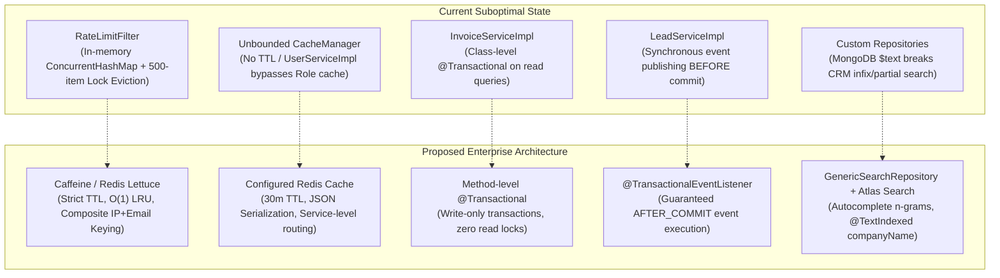
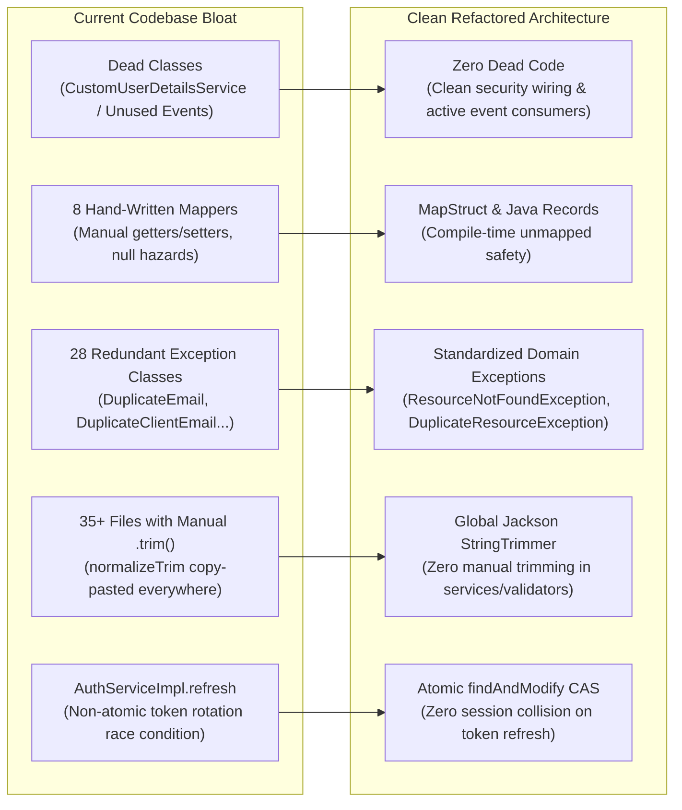
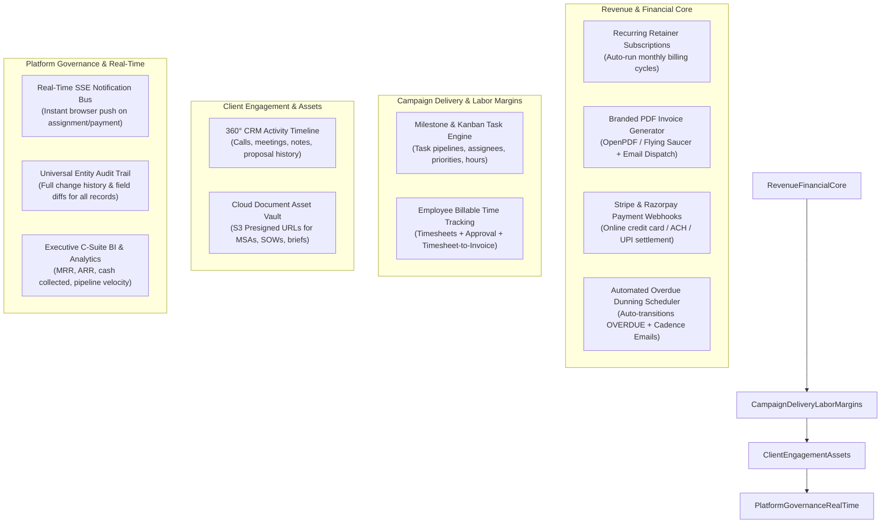
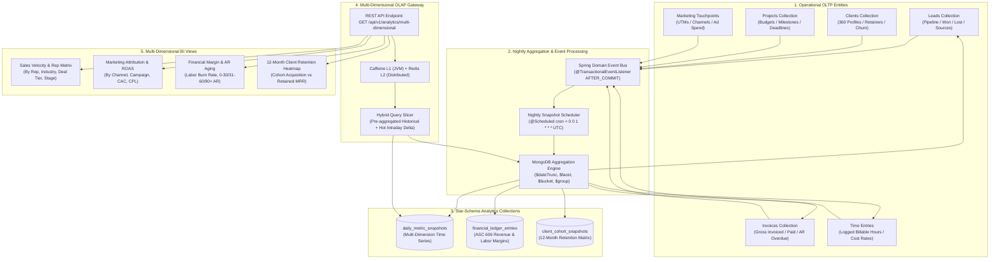

# ElevateCRM: Future Development, Architectural Refactoring & Enterprise Blueprint

## PURPOSE
This document serves as the **strategic technical roadmap, code refactoring manual, and enterprise feature blueprint** for the ElevateCRM / Digital Marketing Agency (DMA) ERP Backend.

While the core system is production-hardened with zero open defects, this document identifies:
1. **Architectural bottlenecks and suboptimal code patterns** that should be rewritten for greater scale, resilience, and maintainability.
2. **Dead code, redundant boilerplate, and code smells** that should be pruned or consolidated.
3. **High-impact commercial features** essential for a multi-million-dollar Digital Marketing Agency ERP that ElevateCRM currently lacks.
4. **A phased engineering implementation roadmap**.

---

# TABLE OF CONTENTS
1. [Architectural Pitfalls & Recommended Code Refactorings](#1-architectural-pitfalls--recommended-code-refactorings)
   - [A. Rate Limiting: From In-Memory Map to Caffeine / Distributed Redis](#a-rate-limiting-from-in-memory-map-to-caffeine--distributed-redis)
   - [B. Caching Architecture: Eliminating Memory Leaks & Service Bypasses](#b-caching-architecture-eliminating-memory-leaks--service-bypasses)
   - [C. MongoDB Transaction Boundaries & Domain Event Publishing](#c-mongodb-transaction-boundaries--domain-event-publishing)
   - [D. Search Engine Modernization: MongoDB Text Indexes vs CRM Substring Search](#d-search-engine-modernization-mongodb-text-indexes-vs-crm-substring-search)
2. [Code Smells, Boilerplate & Dead Weight to Clean Up](#2-code-smells-boilerplate--dead-weight-to-clean-up)
   - [A. Dead & Unused Classes](#a-dead--unused-classes)
   - [B. Hand-Written Boilerplate Mappers vs MapStruct & Java Records](#b-hand-written-boilerplate-mappers-vs-mapstruct--java-records)
   - [C. Exception Proliferation: Consolidating 28 Custom Exceptions](#c-exception-proliferation-consolidating-28-custom-exceptions)
   - [D. Eliminating Manual String Trimming Across 35+ Files](#d-eliminating-manual-string-trimming-across-35-files)
   - [E. Concurrency Race Condition in Refresh Token Rotation](#e-concurrency-race-condition-in-refresh-token-rotation)
   - [F. Redundant Principal Extraction & Duplicate Utility Code](#f-redundant-principal-extraction--duplicate-utility-code)
3. [Enterprise Feature Roadmap for a Commercial Agency ERP](#3-enterprise-feature-roadmap-for-a-commercial-agency-erp)
   - [A. Financial & Invoicing: Recurring Retainers, PDF Generation & Payment Gateways](#a-financial--invoicing-recurring-retainers-pdf-generation--payment-gateways)
   - [B. Campaign Delivery: Milestones, Kanban Tasks & Billable Timesheets](#b-campaign-delivery-milestones-kanban-tasks--billable-timesheets)
   - [C. Sales Funnel: 360° Activity Timelines & Cloud Creative Assets](#c-sales-funnel-360-activity-timelines--cloud-creative-assets)
   - [D. Platform Governance: SSE Notifications, Universal Audit Logs & C-Suite BI](#d-platform-governance-sse-notifications-universal-audit-logs--c-suite-bi)
4. [Data Analysis, Business Intelligence & Multi-Dimensional OLAP Subsystem](#4-data-analysis-business-intelligence--multi-dimensional-olap-subsystem)
   - [A. Agency Unit Economics & Dimensional Analysis Architecture](#a-agency-unit-economics--dimensional-analysis-architecture)
   - [B. Mathematical KPI Formulations & Reference Manual](#b-mathematical-kpi-formulations--reference-manual)
   - [C. Multi-Touch Marketing Attribution Modeling](#c-multi-touch-marketing-attribution-modeling)
   - [D. Production MongoDB Aggregation Pipelines](#d-production-mongodb-aggregation-pipelines)
   - [E. Specialized Star-Schema Analytics Collections](#e-specialized-star-schema-analytics-collections)
   - [F. REST API Endpoints & Slicing Contract](#f-rest-api-endpoints--slicing-contract)
5. [Enterprise Permission Matrix & Navigation Updates](#5-enterprise-permission-matrix--navigation-updates)
6. [Implementation Priority Matrix & Execution Phases](#6-implementation-priority-matrix--execution-phases)

---

# 1. ARCHITECTURAL PITFALLS & RECOMMENDED CODE REFACTORINGS



---

### A. Rate Limiting: From In-Memory Map to Caffeine / Distributed Redis

#### Current File
[`src/main/java/com/viraj/dmabackend/config/RateLimitFilter.java`](file:///home/sayless/DMA/DMA-backend/src/main/java/com/viraj/dmabackend/config/RateLimitFilter.java#L20-L115)

#### Architectural Problems
1. **Arbitrary Eviction Creates a Denial-of-Service / Bypass Vector**:
   ```java
   if (buckets.size() >= MAX_CACHE_SIZE && !buckets.containsKey(bucketKey)) {
       synchronized (evictionLock) {
           if (buckets.size() >= MAX_CACHE_SIZE && !buckets.containsKey(bucketKey)) {
               var iterator = buckets.keySet().iterator();
               int count = 0;
               while (iterator.hasNext() && count < 500) {
                   iterator.next();
                   iterator.remove();
                   count++;
               }
           }
       }
   }
   ```
   - `ConcurrentHashMap.keySet().iterator()` iterates in hash-bucket order, **not** Least-Recently-Used (LRU).
   - If an attacker floods the filter with rotating IP headers, the map hits 10,000 buckets. The eviction purges 500 arbitrary buckets. If a blocked attacker's bucket is purged, their rate limit is **immediately reset**, giving them 5 fresh attempts. Conversely, active legitimate users can have their buckets prematurely evicted.
2. **Global Lock Contention**:
   Under high concurrent login traffic, all threads attempting to register new IPs block on `synchronized (evictionLock)`, causing thread starvation in Tomcat.
3. **Single-JVM State in Multi-Replica Deployments**:
   The in-memory map lives solely inside a single container heap. In a multi-replica production cluster ($N$ pods), rate limiting is not synchronized. An attacker round-robining requests across pods gets $5 \times N$ attempts per minute.
4. **Absence of Principal / Account-Level Throttling**:
   Rate limiting is keyed exclusively on `path + ":" + clientIp`. A distributed credential-stuffing botnet rotating through residential proxies can target a single administrator email with unlimited attempts.

#### Target Architecture & Refactoring
- **Local / Single Pod**: Replace the map and lock with a **Caffeine Cache** featuring native $O(1)$ LRU eviction and access-based TTL.
- **Distributed Production**: Use **Redis** via `bucket4j-redis` (Lettuce driver) or a Redis sliding-window Lua script.
- **Composite Keying**: Enforce dual rate-limit checks: one on `path + ":" + clientIp` (5 req/min) and another on `path + ":" + normalizedEmail` (10 req/min).

```java
// Production-Grade Rate Limiting with Caffeine / Redis
@Component
public class RateLimitFilter extends OncePerRequestFilter {

    private final LoadingCache<String, Bucket> buckets = Caffeine.newBuilder()
            .maximumSize(10_000)
            .expireAfterAccess(Duration.ofMinutes(15))
            .build(key -> Bucket.builder()
                    .addLimit(Bandwidth.builder().capacity(5).refillGreedy(5, Duration.ofMinutes(1)).build())
                    .build());

    // In distributed production, replace with:
    // private final ProxyManager<String> proxyManager; (Bucket4j Redis Lettuce)
}
```

---

### B. Caching Architecture: Eliminating Memory Leaks & Service Bypasses

#### Current Files
- [`src/main/java/com/viraj/dmabackend/auth/service/impl/UserServiceImpl.java`](file:///home/sayless/DMA/DMA-backend/src/main/java/com/viraj/dmabackend/auth/service/impl/UserServiceImpl.java#L272-L279)
- [`src/main/java/com/viraj/dmabackend/auth/service/impl/RoleServiceImpl.java`](file:///home/sayless/DMA/DMA-backend/src/main/java/com/viraj/dmabackend/auth/service/impl/RoleServiceImpl.java#L52-L95)
- [`src/main/java/com/viraj/dmabackend/menu/service/impl/MenuServiceImpl.java`](file:///home/sayless/DMA/DMA-backend/src/main/java/com/viraj/dmabackend/menu/service/impl/MenuServiceImpl.java#L102)

#### Architectural Problems
1. **Fallback to Unbounded `ConcurrentMapCacheManager`**:
   - `spring-boot-starter-cache` and `@EnableCaching` are declared, but there is zero cache provider configuration.
   - Spring Boot defaults to `ConcurrentMapCacheManager`, creating raw `ConcurrentHashMap` instances for `roles`, `role`, `permissions`, and `menuTree`.
   - These caches have **no maximum size, no eviction policy, and no TTL**. They live indefinitely in JVM heap memory.
   - In multi-instance deployments, changes in Node A never evict entries in Node B (cache desynchronization).
2. **Internal Cache Bypass in `UserServiceImpl`**:
   - `RoleServiceImpl` annotates role lookups with `@Cacheable(value = "role", key = "#roleId")`.
   - However, `UserServiceImpl.mapUser()` directly invokes `roleRepository.findById(user.getRoleId())`!
   - Because it injects `RoleRepository` directly instead of calling `RoleService`, it **completely bypasses the cache** on every single user retrieval.
3. **Fragile SpEL Authority Keying in `MenuServiceImpl.getMenuTree`**:
   - Line 102 keys the cache on `T(SecurityContextHolder).getContext().getAuthentication().getAuthorities().toString()`.
   - Authority list string representations can vary in ordering between login sessions, generating duplicate cache entries.
   - If invoked from an asynchronous executor, background task, or scheduled runner, `SecurityContext` is null, defaulting to `'anonymous'`.

#### Target Architecture & Refactoring
1. Define a centralized `CacheConfig` using Redis with JSON serialization and strict 30-minute TTLs.
2. Refactor `UserServiceImpl` to inject `RoleService` rather than `RoleRepository`.
3. Compute menu cache keys using a deterministic SHA-256 hash or sorted role name string.

```java
@Configuration
@EnableCaching
public class CacheConfig {

    @Bean
    public RedisCacheConfiguration defaultCacheConfiguration() {
        return RedisCacheConfiguration.defaultCacheConfig()
                .entryTtl(Duration.ofMinutes(30))
                .disableCachingNullValues()
                .serializeValuesWith(RedisSerializationContext.SerializationPair
                        .fromSerializer(new GenericJackson2JsonRedisSerializer()));
    }
}
```

---

### C. MongoDB Transaction Boundaries & Domain Event Publishing

#### Current Files
- [`src/main/java/com/viraj/dmabackend/invoice/service/impl/InvoiceServiceImpl.java`](file:///home/sayless/DMA/DMA-backend/src/main/java/com/viraj/dmabackend/invoice/service/impl/InvoiceServiceImpl.java#L38)
- [`src/main/java/com/viraj/dmabackend/lead/service/impl/LeadServiceImpl.java`](file:///home/sayless/DMA/DMA-backend/src/main/java/com/viraj/dmabackend/lead/service/impl/LeadServiceImpl.java#L53-L87)
- [`src/main/java/com/viraj/dmabackend/config/MongoConfig.java`](file:///home/sayless/DMA/DMA-backend/src/main/java/com/viraj/dmabackend/config/MongoConfig.java#L18-L20)

#### Architectural Problems
1. **Local Developer Standalone MongoDB Crash**:
   - `MongoConfig` unconditionally registers `MongoTransactionManager`. Multi-document transactions require a replica set (`--replSet`).
   - While `docker-compose.yml` configures `rs0`, `application-dev.yml` points to `localhost:27017` without `replicaSet`. Developers running standalone MongoDB instances crash immediately on calling any `@Transactional` method.
2. **Indiscriminate Class-Level `@Transactional` in `InvoiceServiceImpl`**:
   - Pure read queries (`getAllInvoices`, `getInvoiceById`, `getInvoiceHistory`, `getInvoicesByStatus`) are unnecessarily wrapped in MongoDB write transactions, holding locks and creating unnecessary MVCC snapshot overhead on the cluster.
3. **Premature Domain Event Publishing (Anti-Pattern)**:
   - In `LeadServiceImpl.convertLeadToClient()`, `eventPublisher.publishEvent(new LeadConvertedEvent(eventData))` is called synchronously inside the transactional method **before** the database transaction commits.
   - If subsequent commit logic fails (e.g., write conflict, network partition, replica step-down), any event listener performing non-transactional actions (such as sending emails or webhooks) will have already executed.
   - If a listener throws a runtime exception, it rolls back the entire lead conversion unexpectedly.

#### Target Architecture & Refactoring
1. Remove class-level `@Transactional` on `InvoiceServiceImpl`; annotate strictly mutating methods (`createInvoice`, `updateInvoice`, `updateInvoiceStatus`, `deleteInvoice`).
2. Adopt `@TransactionalEventListener(phase = TransactionPhase.AFTER_COMMIT)` for all domain event consumers.
3. Add a profile-conditional configuration for `MongoTransactionManager`.

```java
@Component
public class LeadConversionEventListener {

    @Async
    @TransactionalEventListener(phase = TransactionPhase.AFTER_COMMIT)
    public void onLeadConverted(LeadConvertedEvent event) {
        // Guaranteed to run ONLY after MongoDB commits successfully
        // Safe to trigger email dispatch, webhooks, or onboarding workflows
    }
}
```

---

### D. Search Engine Modernization: MongoDB Text Indexes vs CRM Substring Search

#### Current Files
- [`src/main/java/com/viraj/dmabackend/client/repository/ClientRepositoryCustomImpl.java`](file:///home/sayless/DMA/DMA-backend/src/main/java/com/viraj/dmabackend/client/repository/ClientRepositoryCustomImpl.java)
- [`src/main/java/com/viraj/dmabackend/lead/repository/LeadRepositoryCustomImpl.java`](file:///home/sayless/DMA/DMA-backend/src/main/java/com/viraj/dmabackend/lead/repository/LeadRepositoryCustomImpl.java)
- [`src/main/java/com/viraj/dmabackend/lead/entity/Lead.java`](file:///home/sayless/DMA/DMA-backend/src/main/java/com/viraj/dmabackend/lead/entity/Lead.java#L31-L44)

#### Architectural Problems
1. **Critical Infix / Substring Limitation of MongoDB `$text`**:
   - All 4 custom repositories use `TextQuery.queryText(TextCriteria.matching(keyword)).sortByScore()`.
   - While replacing `.*regex.*` eliminated full collection scans, MongoDB `$text` indexes tokenize strictly on whole-word whitespace boundaries.
   - Searching `"acm"` will **never** match `"Acme Corporation"`.
   - Searching `"john.d"` or `"@agency.com"` will **never** match `"john.doe@agency.com"`.
   - Users expect type-ahead prefix/infix matching in CRM dashboards.
2. **Missing Text Index Annotation on `Lead.companyName`**:
   - In `Lead.java`, `firstName`, `lastName`, and `email` have `@TextIndexed`. **`companyName` is missing `@TextIndexed`**! Searching leads by company name (a primary sales workflow) returns 0 results.
3. **99% Duplicate Code Across Custom Repositories**:
   - `ClientRepositoryCustomImpl`, `LeadRepositoryCustomImpl`, `ProjectRepositoryCustomImpl`, and `UserRepositoryCustomImpl` duplicate identical query instantiation, count execution, page clamping, and pagination queries.

#### Target Architecture & Refactoring
1. Add `@TextIndexed` immediately to `Lead.companyName`.
2. Consolidate the 4 duplicate custom repository classes into a single reusable generic search executor:
   ```java
   public interface GenericSearchRepository<T> {
       Page<T> search(String keyword, Criteria filterCriteria, Pageable pageable, Class<T> entityClass);
   }
   ```
3. For enterprise search:
   - **MongoDB Atlas**: Configure **Atlas Search** (`$search` with autocomplete edge-ngram analyzer).
   - **Self-Hosted MongoDB**: Use anchored prefix queries (`^keyword`, which leverage standard B-tree indexes) or maintain an edge-ngram token array field on the document.

---

# 2. CODE SMELLS, BOILERPLATE & DEAD WEIGHT TO CLEAN UP



---

### A. Dead & Unused Classes
1. **`CustomUserDetailsService` & `CustomUserDetails`**:
   - Files: [`src/main/java/com/viraj/dmabackend/auth/security/CustomUserDetailsService.java`](file:///home/sayless/DMA/DMA-backend/src/main/java/com/viraj/dmabackend/auth/security/CustomUserDetailsService.java) and [`CustomUserDetails.java`](file:///home/sayless/DMA/DMA-backend/src/main/java/com/viraj/dmabackend/auth/security/CustomUserDetails.java).
   - In `SecurityConfig.java`, no `AuthenticationManager` or `UserDetailsService` is configured. Authentication is executed directly in `AuthServiceImpl`, and `JwtFilter` parses claims directly from the token. `CustomUserDetailsService` is completely unused in production runtime.
2. **`LeadConvertedEvent` without Consumer**:
   - File: [`src/main/java/com/viraj/dmabackend/lead/event/LeadConvertedEvent.java`](file:///home/sayless/DMA/DMA-backend/src/main/java/com/viraj/dmabackend/lead/event/LeadConvertedEvent.java).
   - Published in `LeadServiceImpl.java` line 84, but **zero listeners** exist in the entire codebase.

---

### B. Hand-Written Boilerplate Mappers vs MapStruct & Java Records
- **Problem**: 8 hand-written mapper classes exist across the codebase (`ClientMapper`, `LeadMapper`, `ProjectMapper`, `InvoiceMapper`, `MenuMapper`, `RoleMapper`, `UserMapper`, `PermissionMapper`).
- **Risks & Flaws**:
  - Adding a new field requires manually updating the Entity, Request DTO, Response DTO, Mapper, and Mapper unit test.
  - If a developer misses a field, it silently serializes as `null` in the API response with zero compile-time warnings.
  - Inconsistency: `InvoiceMapper` handles both entity mapping and updates, whereas `ClientServiceImpl`, `LeadServiceImpl`, and `ProjectServiceImpl` implement private `buildX()` and `updateXFields()` methods inside their service classes.
- **Solution**: Adopt **MapStruct** with `unmappedTargetPolicy = ReportingPolicy.ERROR` to guarantee compile-time verification, and convert immutable Response DTOs to Java 17 `record`s.

---

### C. Exception Proliferation: Consolidating 28 Custom Exceptions
- **Problem**: 28 custom exception classes exist across domains. The vast majority are identical 5-line wrappers around `BadRequestException` or `ResourceNotFoundException`:
  - `ClientNotFoundException`, `UserNotFoundException`, `LeadNotFoundException`, `RoleNotFoundException`, `ProjectNotFoundException`, `MenuNotFoundException`, `ParentMenuNotFoundException`.
  - `DuplicateEmailException` vs `DuplicateClientEmailException`.
  - `DuplicatePhoneException` vs `DuplicateClientPhoneException`.
  - `DuplicateLeadException`, `DuplicateProjectException`, `DuplicateMenuTitleException`, `DuplicateMenuPathException`.
- **Solution**: Consolidate into standardized parameterized exceptions:
  ```java
  throw new ResourceNotFoundException("Client", clientId);
  throw new DuplicateResourceException("Client", "email", email);
  ```

---

### D. Eliminating Manual String Trimming Across 35+ Files
- **Problem**: Helper methods like `normalizeTrim(value)` and `normalizeEmail(email)` or inline ternaries `val != null ? val.trim() : null` are manually written across dozens of service methods and validators.
- **Solution**: Register a global Jackson deserializer or Spring `@ControllerAdvice` `StringTrimmerEditor`. All incoming JSON strings will be automatically trimmed on deserialization before reaching controllers:
  ```java
  @Bean
  public Jackson2ObjectMapperBuilderCustomizer jacksonCustomizer() {
      return builder -> builder.deserializerByType(String.class, new StdScalarDeserializer<String>(String.class) {
          @Override
          public String deserialize(JsonParser p, DeserializationContext ctxt) throws IOException {
              return p.getValueAsString() != null ? p.getValueAsString().trim() : null;
          }
      });
  }
  ```

---

### E. Concurrency Race Condition in Refresh Token Rotation
- **Problem**: In [`AuthServiceImpl.refresh`](file:///home/sayless/DMA/DMA-backend/src/main/java/com/viraj/dmabackend/auth/service/impl/AuthServiceImpl.java#L110-L155), token rotation is non-atomic:
  1. Finds token by value.
  2. If `token.isRevoked()`, deletes all tokens for user (`deleteByUserId`) assuming reuse attack.
  3. Sets `revoked = true` and saves.
  4. Generates and saves new token.
- **The Concurrency Failure**: If a browser client fires 2 parallel API requests when an access token expires, both hit `refresh()` simultaneously. Request 2 reads `isRevoked() == true` after Request 1 completes, triggers the compromised token branch, and wipes **ALL** refresh tokens for that user, abruptly logging them out of all active sessions!
- **Solution**: Use atomic compare-and-swap via `mongoTemplate.findAndModify` querying `Criteria.where("token").is(token).and("revoked").is(false)` to ensure only one thread can transition the refresh token.

---

### F. Redundant Principal Extraction & Duplicate Utility Code
- [`AuditorAwareConfig.java`](file:///home/sayless/DMA/DMA-backend/src/main/java/com/viraj/dmabackend/config/AuditorAwareConfig.java#L20-L40) contains a 24-line principal extraction routine that is a 100% duplicate of [`SecurityUtils.getCurrentUserEmail()`](file:///home/sayless/DMA/DMA-backend/src/main/java/com/viraj/dmabackend/auth/security/SecurityUtils.java#L15-L38).
- `AuditorAwareConfig` should delegate directly to `SecurityUtils.getCurrentUserEmail()`.

---

# 3. ENTERPRISE FEATURE ROADMAP FOR A COMMERCIAL AGENCY ERP

A real digital marketing agency is an **asset-intensive, retainer-driven, billable-hour service provider**. Below are the high-impact functional capabilities ElevateCRM must introduce to compete with commercial agency ERPs:



---

### A. Financial & Invoicing: Recurring Retainers, PDF Generation & Payment Gateways

#### 1. Automated Recurring Retainers & Subscriptions
- **Why Needed**: Marketing agencies run on monthly retainers (e.g. SEO maintenance, ad spend management, content retainers). Currently, finance staff must manually generate every invoice each month.
- **Entity**: `RecurringInvoice.java` (`collection = "recurring_invoices"`).
  - Fields: `clientId`, `projectId`, `title`, `frequency` (`MONTHLY`, `QUARTERLY`, `ANNUALLY`), `startDate`, `endDate`, `nextRunDate`, `items`, `taxPercentage`, `discount`, `autoSend`, `status` (`ACTIVE`, `PAUSED`, `COMPLETED`).
- **Scheduled Job**: Runs daily at 02:00 UTC: `@Scheduled(cron = "0 0 2 * * *", zone = "UTC")`.
  - Queries active retainers where `nextRunDate <= todayUTC`.
  - Generates the standard `Invoice` via `InvoiceServiceImpl`, updates `totalCyclesRun`, and increments `nextRunDate`.

#### 2. Branded PDF Invoice Generation & Email Dispatch
- **Why Needed**: Invoices currently exist solely as JSON in MongoDB. Enterprise clients require official PDF tax invoices delivered directly via email.
- **Tech Stack**: `spring-boot-starter-mail`, `thymeleaf`, and `openpdf` / `flying-saucer-pdf`.
- **Endpoints**:
  - `GET /api/v1/invoices/{id}/pdf` — Streams binary PDF directly to the browser.
  - `POST /api/v1/invoices/{id}/send` — Generates PDF, emails it to client's primary contact, transitions status to `SENT`, and logs to `invoice_history`.

#### 3. Online Payment Gateway Integration (Stripe & Razorpay)
- **Why Needed**: Marking invoices `PAID` is currently manual. Clients should pay online via card/ACH/UPI.
- **Entity**: `PaymentTransaction.java` (`collection = "payment_transactions"`).
  - Fields: `invoiceId`, `clientId`, `gateway` (`STRIPE`, `RAZORPAY`), `gatewayTransactionId` (unique idempotency key), `amount`, `status`, `processedAt`.
- **Endpoints**:
  - `POST /api/v1/invoices/{id}/checkout-session` — Generates a hosted payment URL.
  - `POST /api/v1/webhooks/stripe` & `/razorpay` — Public endpoints validating vendor HMAC signatures, recording transactions, and automatically transitioning invoices to `PAID`.

#### 4. Automated Overdue Invoice Scheduler & Dunning Engine
- **Why Needed**: `InvoiceStatus.OVERDUE` exists in the codebase, but the transition is entirely manual.
- **Scheduled Job**: Runs daily at 01:00 UTC: `@Scheduled(cron = "0 0 1 * * *", zone = "UTC")`.
  - Batch-transitions invoices where `status == SENT && dueDate < todayUTC` to `OVERDUE`.
  - Dispatches automated dunning emails based on cadence rules (+3 days, +7 days, +14 days).

---

### B. Campaign Delivery: Milestones, Kanban Tasks & Billable Timesheets

#### 1. Deliverables, Milestones & Kanban Tasks
- **Why Needed**: Currently, `Project` only records a name, budget, and dates. There are no sub-tasks, no assignees, no deliverables, and no Kanban pipeline. Agency staff are forced to manage campaigns in external tools (Asana, Trello).
- **Entities**:
  - `ProjectMilestone.java` (`collection = "project_milestones"`): Deliverable milestones with due dates.
  - `ProjectTask.java` (`collection = "project_tasks"`): Independent collection (avoiding MongoDB 16MB document limits and write locks).
    - Fields: `projectId`, `milestoneId`, `title`, `description`, `status` (`BACKLOG`, `TODO`, `IN_PROGRESS`, `IN_REVIEW`, `COMPLETED`, `BLOCKED`), `priority` (`LOW`, `MEDIUM`, `HIGH`, `URGENT`), `assignedUserIds`, `estimatedHours`, `actualHours`, `dueDate`, `orderIndex` (for Kanban drag-and-drop sort order).
- **Endpoints**:
  - `POST /api/v1/projects/{id}/tasks` — Create task.
  - `GET /api/v1/projects/{id}/kanban` — Returns tasks partitioned into status columns for frontend Kanban boards.
  - `PATCH /api/v1/tasks/{id}/status` — Real-time drag-and-drop status update.

#### 2. Employee Billable Time Tracking & Timesheet-to-Invoice
- **Why Needed**: Agencies cannot determine if retainer contracts or fixed projects are profitable without tracking labor hours against campaigns.
- **Entity**: `TimeEntry.java` (`collection = "time_entries"`).
  - Fields: `projectId`, `taskId`, `userId`, `date`, `durationMinutes`, `billable`, `hourlyRate`, `billableAmount`, `status` (`DRAFT`, `SUBMITTED`, `APPROVED`, `INVOICED`), `invoiceId`.
- **Workflow**:
  - Employee logs time $\rightarrow$ submits weekly timesheet $\rightarrow$ manager approves $\rightarrow$ finance converts unbilled approved hours directly into a draft invoice (`POST /api/v1/invoices/generate-from-time`).

---

### C. Sales Funnel: 360° Activity Timelines & Cloud Creative Assets

#### 1. 360° CRM Activity Timeline & Interaction History
- **Why Needed**: Sales cycles take weeks of discovery calls, pitches, and emails. Leads and clients currently only have a single `notes` string. Overwriting notes erases past history.
- **Entity**: `Activity.java` (`collection = "activities"`).
  - Polymorphic fields: `targetType` (`LEAD`, `CLIENT`, `PROJECT`), `targetId`, `activityType` (`CALL`, `MEETING`, `EMAIL`, `NOTE`, `PROPOSAL_SENT`, `SYSTEM_EVENT`), `subject`, `content`, `activityDate`, `performedByUserId`.
  - When `leadService.convertLeadToClient()` runs, an automated system activity is logged: *"System: Converted Lead to Client ID: xyz"*.

#### 2. Cloud Document & Creative Asset Management
- **Why Needed**: Agencies generate contracts (MSAs, SOWs), creative briefs, brand logos, and reports.
- **Storage Architecture**: Cloud Object Storage (Amazon S3 / Cloudflare R2). Binary files are never stored as BSON blobs in MongoDB.
- **Pattern**: Direct-to-Cloud Upload via Presigned URLs:
  1. Frontend requests presigned URL from ElevateCRM (`POST /api/v1/documents/presigned-upload-url`).
  2. Frontend uploads file directly to S3.
  3. Frontend posts metadata to ElevateCRM to record document asset.

---

### D. Platform Governance: SSE Notifications, Universal Audit Logs & C-Suite BI

#### 1. Real-Time Notification Bus (Server-Sent Events)
- **Why Needed**: Users must refresh browsers to see new lead assignments, paid invoices, or task blockers.
- **Implementation**: Spring `SseEmitter` over standard HTTP/2. Unidirectional, low overhead, automatic browser reconnection.
- **Endpoint**: `GET /api/v1/notifications/stream` pushes live badge updates when domain events fire.

#### 2. Universal Audit Trail & Field Diffs
- **Why Needed**: Only invoices currently have history. If an employee alters a client GST number, reduces a project budget from $50K to $10K, or deletes a lead, there is zero historical record.
- **Entity**: `AuditLog.java` (`collection = "audit_logs"`).
  - Fields: `entityName`, `entityId`, `action` (`CREATE`, `UPDATE`, `DELETE`, `STATUS_CHANGE`), `performedBy`, `timestamp`, `diffs` (list of old vs new values).

#### 3. Executive C-Suite Overview & Metric Alerts
- **Why Needed**: Leadership requires real-time summary indicators and anomaly detection (e.g., sudden drop in weekly lead intake or spike in overdue receivables).
- **Implementation**: Real-time summary endpoint delivering high-level executive cards, integrated into the multi-dimensional analytics engine below.

---

# 4. DATA ANALYSIS, BUSINESS INTELLIGENCE & MULTI-DIMENSIONAL OLAP SUBSYSTEM



### A. Agency Unit Economics & Dimensional Analysis Architecture
A commercial Digital Marketing Agency differs fundamentally from generic SaaS or retail businesses:
1. **ASC 606 Revenue Segregation**: ElevateCRM must strictly isolate **Gross Invoiced Billings** from **Pass-Through Ad Media Spend** (direct Facebook/Google ad network charges billed to clients). Agency Net Revenue is strictly the management fee / service billing.
2. **Direct Labor Burn & Project Gross Margin**: Profitability is determined by deducting tracked employee hourly cost rates (`durationMinutes / 60 * employeeCostRate`) and freelance contractor expenses from the project's recognized service revenue.
3. **Accounts Receivable Aging Dynamics**: Agencies provide 15-day or 30-day payment terms. Invoices must be dynamically classified into aging buckets (`CURRENT`, `OVERDUE_1_30`, `OVERDUE_31_60`, `OVERDUE_61_90`, `OVERDUE_90_PLUS`) with Days Sales Outstanding (DSO) calculation.
4. **Subscription-Style Retainer Health**: Recurring marketing retainers require SaaS-grade cohort metrics: Monthly Recurring Revenue (MRR), Annual Recurring Revenue (ARR), Net Revenue Retention (NRR), Logo Churn, and Retainer Realization Rate (effective billable rate vs target rate card).

---

### B. Mathematical KPI Formulations & Reference Manual

Every calculation in the analytics engine is safeguarded against division-by-zero errors using $\max(\text{denominator}, 1)$ or $0.01$:

| Metric | Mathematical Formula | DMA Production Benchmark / Target |
| :--- | :--- | :--- |
| **Win/Loss Ratio** | $\frac{N_{\text{won}}}{\max(N_{\text{lost}}, 1)}$ | $> 1.5$ (Healthy sales pipeline) |
| **Win Rate %** | $\frac{N_{\text{won}}}{N_{\text{won}} + N_{\text{lost}}} \times 100\%$ | $25\% - 40\%$ across agency benchmarks |
| **Weighted Pipeline Value** | $\sum_{d \in \text{OpenDeals}} (\text{estimatedBudget}_d \times P(\text{stage}_d))$ | Real-time expected pipeline revenue |
| **Sales Cycle Duration ($\overline{T}$)** | $\frac{1}{N_{\text{won}}} \sum_{i=1}^{N_{\text{won}}} (\text{convertedAt}_i - \text{createdAt}_i) \text{ in days}$ | Target: $14 - 35$ calendar days |
| **Pipeline Velocity ($V$)** | $V = \frac{N_{\text{active}} \times \text{ACV} \times (\text{WinRate\%} / 100)}{\max(\overline{T}_{\text{close}}, 1)}$ | Projected sales revenue per day ($\$ / \text{day}$) |
| **Blended Customer Acquisition Cost (CAC)** | $\frac{\sum \text{Ad Media Spend} + \sum \text{Marketing Tools} + \sum \text{Sales Compensation}}{\text{Total New Paying Clients Acquired}}$ | Calculated per acquisition period |
| **Channel-Specific CAC** | $\text{CAC}_c = \frac{\text{Direct Ad Spend}_c + \text{Allocated Overhead}_c}{\max(\text{Attributed Clients}_c, 1)}$ | Target: $< 25\%$ of first-year client LTV |
| **Return on Ad Spend (ROAS)** | $\text{ROAS}_c = \frac{\text{Attributed Net Revenue}_c}{\text{Ad Spend}_c}$ | $\ge 4.0\text{x}$ ($400\%$ return) |
| **Cost Per Lead (CPL) & CPA** | $\text{CPL} = \frac{\text{Spend}_c}{\text{Leads}_c}, \quad \text{CPA} = \frac{\text{Spend}_c}{\text{Paying Clients}_c}$ | Unit acquisition cost per channel |
| **MQL $\to$ SQL Rate** | $\frac{\text{Leads reaching QUALIFIED}}{\text{Total Ingested Leads (NEW + CONTACTED)}} \times 100\%$ | Target: $30\% - 50\%$ qualification rate |
| **Net Agency Gross Margin %** | $\frac{\text{Net Agency Revenue} - \text{Labor Cost} - \text{Subcontractors} - \text{Direct Tools}}{\text{Net Agency Revenue (Excl. Pass-Through)}} \times 100\%$ | Target: $50\% - 70\%$ agency margin |
| **Labor Burn Rate %** | $\frac{\sum (\text{Logged Hours} \times \text{Employee Cost Rate})}{\text{Allocated Project Labor Budget}} \times 100\%$ | Safe: $\le 100\%$; Warning: $> 100\%$ |
| **Retainer Realization Rate** | $\frac{\text{Billed Monthly Retainer Fee} / \max(\text{Actual Logged Hours}, 1.0)}{\text{Target Contract Hourly Rate}} \times 100\%$ | Target: $95\% - 110\%$ |
| **Days Sales Outstanding (DSO)**| $\frac{\text{Total Accounts Receivable}}{\text{Total Annual Invoiced Credit}} \times 365$ | Target: $< 35$ days |
| **Monthly Recurring Revenue (MRR)**| $\sum_{c \in \text{Active Clients}} \text{Monthly Retainer Value}_c$ | Predictable base monthly revenue |
| **Annual Recurring Revenue (ARR)**| $\text{MRR} \times 12$ | Annualized run-rate revenue |
| **Net Revenue Retention (NRR)** | $\frac{\text{Starting MRR} + \text{Expansion MRR} - \text{Contraction MRR} - \text{Churned MRR}}{\text{Starting MRR}} \times 100\%$ | Target: $> 105\%$ (Net negative churn) |
| **Logo Churn Rate %** | $\frac{\text{Clients Terminated in Month } m}{\text{Active Clients at Start of Month } m} \times 100\%$ | Target: $< 2.0\% / \text{month}$ |
| **Customer Lifetime Value (LTV)**| $\text{LTV} = \frac{\text{Average Revenue Per User (ARPU)} \times (\text{Gross Margin \%} / 100)}{\max(\text{Monthly Logo Churn Rate}, 0.01)}$ | Total expected client value |
| **LTV : CAC Ratio** | $\frac{\text{LTV}}{\text{Blended CAC}}$ | $\ge 3.0\text{x}$ (Healthy), $\ge 5.0\text{x}$ (High growth) |

---

### C. Multi-Touch Marketing Attribution Modeling
Marketing touchpoints are recorded sequentially in the `marketing_touchpoints` collection as prospects interact with agency campaigns. When a deal closes ($V = \text{Contract Value}$), revenue attribution across touchpoints $\mathbf{T} = \langle t_1, t_2, \dots, t_k \rangle$ is computed via three selectable models:
1. **First-Touch Attribution (FTA)**: Attributes 100% of revenue to the discovery channel ($W(t_1) = 1.0$). Best for optimizing top-of-funnel brand awareness spend.
2. **Last-Touch Attribution (LTA)**: Attributes 100% of revenue to the conversion channel immediately preceding qualification ($W(t_k) = 1.0$). Best for closing channels.
3. **Linear Multi-Touch Attribution (MTA)**: Distributes credit equally across all touchpoints ($W(t_j) = \frac{1}{k}$). Best for evaluating omnichannel campaign contributions.

---

### D. Production MongoDB Aggregation Pipelines

#### 1. Multi-Dimensional Sales Performance & Pipeline Velocity Pipeline
```javascript
db.leads.aggregate([
  {
    $match: {
      deleted: false,
      createdAt: {
        $gte: ISODate("2026-01-01T00:00:00.000Z"),
        $lte: ISODate("2026-12-31T23:59:59.999Z")
      }
    }
  },
  {
    $project: {
      assignedUserId: { $ifNull: ["$assignedUserId", "UNASSIGNED"] },
      status: 1,
      estimatedBudget: { $ifNull: ["$estimatedBudget", 0] },
      industry: { $ifNull: ["$industry", "GENERAL"] },
      timeBucket: { $dateTrunc: { date: "$createdAt", unit: "month", timezone: "UTC" } },
      timeToCloseDays: {
        $cond: {
          if: { $and: [{ $eq: ["$status", "WON"] }, { $ne: ["$convertedAt", null] }] },
          then: { $divide: [{ $subtract: ["$convertedAt", "$createdAt"] }, 1000 * 60 * 60 * 24] },
          else: null
        }
      },
      stageWeight: {
        $switch: {
          branches: [
            { case: { $eq: ["$status", "NEW"] }, then: 0.10 },
            { case: { $eq: ["$status", "CONTACTED"] }, then: 0.20 },
            { case: { $eq: ["$status", "QUALIFIED"] }, then: 0.40 },
            { case: { $eq: ["$status", "PROPOSAL_SENT"] }, then: 0.60 },
            { case: { $eq: ["$status", "NEGOTIATION"] }, then: 0.80 },
            { case: { $eq: ["$status", "WON"] }, then: 1.00 }
          ],
          default: 0.00
        }
      }
    }
  },
  {
    $group: {
      _id: { timeBucket: "$timeBucket", assignedUserId: "$assignedUserId" },
      totalLeads: { $sum: 1 },
      wonCount: { $sum: { $cond: [{ $eq: ["$status", "WON"] }, 1, 0] } },
      lostCount: { $sum: { $cond: [{ $eq: ["$status", "LOST"] }, 1, 0] } },
      pipelineValue: {
        $sum: {
          $cond: [
            { $in: ["$status", ["NEW", "CONTACTED", "QUALIFIED", "PROPOSAL_SENT", "NEGOTIATION"]] },
            "$estimatedBudget",
            0
          ]
        }
      },
      weightedPipelineValue: { $sum: { $multiply: ["$estimatedBudget", "$stageWeight"] } },
      wonRevenue: { $sum: { $cond: [{ $eq: ["$status", "WON"] }, "$estimatedBudget", 0] } },
      avgTimeToCloseDays: { $avg: "$timeToCloseDays" }
    }
  },
  {
    $project: {
      _id: 0,
      timeBucket: "$_id.timeBucket",
      assignedUserId: "$_id.assignedUserId",
      totalLeads: 1,
      wonCount: 1,
      lostCount: 1,
      pipelineValue: 1,
      weightedPipelineValue: 1,
      wonRevenue: 1,
      avgTimeToCloseDays: { $ifNull: ["$avgTimeToCloseDays", 0.0] },
      winRatePercentage: {
        $cond: {
          if: { $gt: [{ $add: ["$wonCount", "$lostCount"] }, 0] },
          then: { $multiply: [{ $divide: ["$wonCount", { $add: ["$wonCount", "$lostCount"] }] }, 100] },
          else: 0.0
        }
      },
      averageDealSize: {
        $cond: {
          if: { $gt: ["$wonCount", 0] },
          then: { $divide: ["$wonRevenue", "$wonCount"] },
          else: 0.0
        }
      }
    }
  },
  { $sort: { timeBucket: 1, wonRevenue: -1 } }
]);
```

#### 2. Accounts Receivable (AR) Aging Buckets & Risk Stratification
```javascript
db.invoices.aggregate([
  {
    $match: {
      active: true,
      status: { $in: ["SENT", "OVERDUE"] },
      totalAmount: { $gt: 0 }
    }
  },
  {
    $addFields: {
      daysOverdue: {
        $max: [
          0,
          {
            $divide: [
              { $subtract: [new Date(), { $toDate: "$dueDate" }] },
              1000 * 60 * 60 * 24
            ]
          }
        ]
      }
    }
  },
  {
    $facet: {
      agingBuckets: [
        {
          $bucket: {
            groupBy: "$daysOverdue",
            boundaries: [0, 1, 31, 61, 91],
            default: "90_PLUS_DAYS",
            output: {
              count: { $sum: 1 },
              totalOutstandingAmount: { $sum: "$totalAmount" }
            }
          }
        },
        {
          $project: {
            bucketLabel: {
              $switch: {
                branches: [
                  { case: { $eq: ["$_id", 0] }, then: "CURRENT" },
                  { case: { $eq: ["$_id", 1] }, then: "OVERDUE_1_30" },
                  { case: { $eq: ["$_id", 31] }, then: "OVERDUE_31_60" },
                  { case: { $eq: ["$_id", 61] }, then: "OVERDUE_61_90" },
                  { case: { $eq: ["$_id", "90_PLUS_DAYS"] }, then: "OVERDUE_90_PLUS" }
                ],
                default: "UNKNOWN"
              }
            },
            count: 1,
            totalOutstandingAmount: { $round: ["$totalOutstandingAmount", 2] }
          }
        }
      ],
      summary: [
        {
          $group: {
            _id: null,
            totalReceivables: { $sum: "$totalAmount" },
            overdueReceivables: {
              $sum: { $cond: [{ $gt: ["$daysOverdue", 0] }, "$totalAmount", 0] }
            },
            totalOpenInvoices: { $sum: 1 }
          }
        },
        {
          $project: {
            _id: 0,
            totalReceivables: { $round: ["$totalReceivables", 2] },
            overdueReceivables: { $round: ["$overdueReceivables", 2] },
            totalOpenInvoices: 1,
            overduePercentage: {
              $cond: {
                if: { $gt: ["$totalReceivables", 0] },
                then: { $multiply: [{ $divide: ["$overdueReceivables", "$totalReceivables"] }, 100] },
                else: 0.0
              }
            }
          }
        }
      ]
    }
  }
]);
```

#### 3. 12-Month Client Retention & Revenue Expansion Cohort Heatmap
```javascript
db.clients.aggregate([
  { $match: { deleted: false, createdAt: { $gte: ISODate("2025-01-01T00:00:00.000Z") } } },
  {
    $project: {
      clientId: "$_id",
      companyName: 1,
      cohortMonth: { $dateToString: { format: "%Y-%m", date: "$createdAt", timezone: "UTC" } },
      acquisitionDate: "$createdAt"
    }
  },
  {
    $lookup: {
      from: "invoices",
      let: { cId: "$clientId" },
      pipeline: [
        {
          $match: {
            $expr: {
              $and: [
                { $eq: ["$clientId", "$$cId"] },
                { $eq: ["$status", "PAID"] },
                { $eq: ["$active", true] }
              ]
            }
          }
        },
        {
          $project: {
            paidDate: { $toDate: "$paidDate" },
            totalAmount: 1
          }
        }
      ],
      as: "billingEvents"
    }
  },
  { $unwind: { path: "$billingEvents", preserveNullAndEmptyArrays: true } },
  {
    $project: {
      cohortMonth: 1,
      clientId: 1,
      invoiceAmount: { $ifNull: ["$billingEvents.totalAmount", 0] },
      relativeMonth: {
        $floor: {
          $divide: [
            { $subtract: ["$billingEvents.paidDate", "$acquisitionDate"] },
            1000 * 60 * 60 * 24 * 30.4375
          ]
        }
      }
    }
  },
  { $match: { relativeMonth: { $gte: 0, $lte: 12 } } },
  {
    $group: {
      _id: { cohortMonth: "$cohortMonth", relativeMonth: "$relativeMonth" },
      uniqueRetainedClients: { $addToSet: "$clientId" },
      cohortMonthRevenue: { $sum: "$invoiceAmount" }
    }
  },
  {
    $project: {
      cohortMonth: "$_id.cohortMonth",
      relativeMonth: "$_id.relativeMonth",
      retainedClientCount: { $size: "$uniqueRetainedClients" },
      cohortMonthRevenue: { $round: ["$cohortMonthRevenue", 2] }
    }
  },
  { $sort: { cohortMonth: 1, relativeMonth: 1 } }
]);
```

---

### E. Specialized Star-Schema Analytics Collections

1. **`DailyMetricSnapshot.java` (`daily_metric_snapshots`)**:
   - Stores pre-aggregated daily summaries per dimension slice, ensuring sub-50ms query speeds.
   - Unique Index: `@CompoundIndex(name = "idx_snapshot_dim", def = "{'snapshotDate': 1, 'dimensionType': 1, 'dimensionValue': 1}", unique = true)`.
   - Secondary Index: `@CompoundIndex(name = "idx_dim_time", def = "{'dimensionType': 1, 'dimensionValue': 1, 'snapshotDate': 1}")`.
   - Metrics Stored: `leadsCreated`, `leadsWon`, `leadsLost`, `pipelineValue`, `weightedPipelineValue`, `wonRevenue`, `adSpend`, `attributedRevenueLinear`, `invoicedRevenue`, `collectedCash`, `passThroughAdSpend`, `internalLaborCost`, `grossMargin`, `loggedBillableHours`.

2. **`FinancialLedgerEntry.java` (`financial_ledger_entries`)**:
   - Granular ledger for ASC 606 revenue recognition, employee labor costs, and vendor media bills.
   - Compound Indexes: `{"clientId": 1, "entryDate": 1}`, `{"projectId": 1, "category": 1, "entryDate": 1}`.
   - Categories: `PASS_THROUGH_AD_SPEND`, `DIRECT_LABOR`, `SUBCONTRACTOR_FREELANCE`, `SOFTWARE_TOOL_LICENSE`, `AGENCY_RETAINER_FEE`.

3. **`MarketingTouchpoint.java` (`marketing_touchpoints`)**:
   - Records every pre-conversion channel interaction (Google Ads, LinkedIn, Meta, SEO, Referral).
   - Compound Indexes: `{"leadId": 1, "touchpointTimestamp": 1}`, `{"channel": 1, "campaignName": 1, "touchpointTimestamp": 1}`.
   - Fields: `leadId`, `clientId`, `channel` (`LeadSource`), `campaignName`, `utmSource`, `utmMedium`, `utmCampaign`, `touchpointTimestamp`, `sequenceIndex`.

4. **`ClientCohortSnapshot.java` (`client_cohort_snapshots`)**:
   - Monthly client retention matrix (`cohortMonth` unique index).
   - Contains 13 monthly retention slices (Months 0..12) storing `retainedClientCount`, `retainedMrr`, `expansionMrr`, `churnedMrr`, `logoRetentionRate`, and `netRevenueRetentionRate`.

---

### F. REST API Endpoints & Slicing Contract

The analytics engine exposes flexible slice-and-dice endpoints under `/api/v1/analytics`:

```text
GET /api/v1/analytics/multi-dimensional
    ?metric=REVENUE
    &dimension=LEAD_SOURCE
    &granularity=MONTHLY
    &from=2026-01-01
    &to=2026-12-31
    &comparePriorPeriod=true
```

- **Supported Request Parameters**:
  - `metric`: `REVENUE`, `PIPELINE_VALUE`, `WEIGHTED_PIPELINE`, `WIN_RATE`, `SALES_VELOCITY`, `TIME_TO_CLOSE`, `AVERAGE_DEAL_SIZE`, `CAC`, `ROAS`, `CPL`, `CPA`, `GROSS_MARGIN_PERCENTAGE`, `LABOR_BURN_RATE`, `RETAINER_REALIZATION_RATE`, `ACCOUNTS_RECEIVABLE_OVERDUE`, `MRR`, `ARR`, `NRR`, `LOGO_CHURN_RATE`.
  - `dimension`: `GLOBAL`, `SALES_REP`, `CLIENT`, `INDUSTRY`, `DEAL_SIZE_TIER`, `LEAD_SOURCE`, `CAMPAIGN`, `PROJECT`, `EXPENSE_CATEGORY`.
  - `granularity`: `DAILY`, `WEEKLY`, `MONTHLY`, `QUARTERLY`, `YEARLY`.
  - `attributionModel`: `FIRST_TOUCH`, `LAST_TOUCH`, `LINEAR` (active when analyzing marketing metrics).
  - `comparePriorPeriod`: `true` / `false` (computes Year-over-Year or Quarter-over-Quarter comparative delta %).
- **Dedicated Analytical Endpoints**:
  - `GET /api/v1/analytics/finance/ar-aging` — Real-time Accounts Receivable aging stratification and DSO metrics.
  - `GET /api/v1/analytics/cohorts/retention` — 12-month client and revenue retention cohort matrix.
  - `GET /api/v1/analytics/sales/velocity` — Sales team conversion speed and weighted pipeline by representative.
  - `POST /api/v1/analytics/admin/snapshots/rollup` — Administrative trigger to recalculate specific date snapshots.

---

# 5. ENTERPRISE PERMISSION MATRIX & NAVIGATION UPDATES

To support these enterprise features, the following permissions should be registered in `PermissionType.java`:

| Module | Permission Type | Capability Description | Minimum Role |
| :--- | :--- | :--- | :--- |
| **RETAINER** | `RETAINER_CREATE`, `RETAINER_READ`, `RETAINER_UPDATE`, `RETAINER_DELETE` | Manage recurring retainer contracts | `ROLE_MANAGER` |
| **TASK** | `TASK_CREATE`, `TASK_READ`, `TASK_UPDATE`, `TASK_DELETE` | Manage campaign Kanban tasks | `ROLE_EMPLOYEE` |
| **MILESTONE** | `MILESTONE_CREATE`, `MILESTONE_READ`, `MILESTONE_UPDATE`, `MILESTONE_DELETE` | Manage deliverable milestones | `ROLE_MANAGER` |
| **TIME** | `TIME_CREATE`, `TIME_READ`, `TIME_UPDATE`, `TIME_DELETE`, `TIME_APPROVE` | Log and approve billable timesheets | `ROLE_EMPLOYEE` (`TIME_APPROVE`: `ROLE_MANAGER`) |
| **ACTIVITY** | `ACTIVITY_CREATE`, `ACTIVITY_READ`, `ACTIVITY_UPDATE`, `ACTIVITY_DELETE` | Manage 360° interaction notes | `ROLE_EMPLOYEE` |
| **DOCUMENT** | `DOCUMENT_CREATE`, `DOCUMENT_READ`, `DOCUMENT_DELETE` | Upload and access S3 creative assets | `ROLE_EMPLOYEE` |
| **NOTIFICATION** | `NOTIFICATION_READ`, `NOTIFICATION_UPDATE` | Access live SSE notification feed | `ROLE_EMPLOYEE` |
| **AUDIT** | `AUDIT_READ` | Inspect universal historical audit logs | `ROLE_OWNER` |
| **ANALYTICS** | `ANALYTICS_READ`, `ANALYTICS_EXPORT`, `ANALYTICS_REFRESH` | Access multi-dimensional OLAP analytics | `ROLE_MANAGER` (`REFRESH`: `ROLE_OWNER`) |

---

# 6. IMPLEMENTATION PRIORITY MATRIX & EXECUTION PHASES

| Phase | Category | Focus Area | High-Impact Deliverables |
| :--- | :--- | :--- | :--- |
| **Phase 1** | **Tech Debt & Resilience** | Core Code Quality | 1. Replace in-memory rate limiting with Caffeine/Redis.<br>2. Fix refresh token rotation race condition via atomic `findAndModify`.<br>3. Fix `UserServiceImpl` cache bypass and add Redis cache config.<br>4. Consolidate 28 custom exceptions into standardized domain exceptions.<br>5. Add `@TextIndexed` to `Lead.companyName` and extract shared search repo. |
| **Phase 2** | **Revenue & Cash Flow** | Financial Automation | 1. Implement branded PDF invoice generation and direct email dispatch.<br>2. Integrate Stripe & Razorpay checkout sessions and webhooks.<br>3. Build recurring retainer subscription engine and scheduler.<br>4. Implement daily overdue dunning scheduler. |
| **Phase 3** | **Agency Operations** | Campaign Delivery | 1. Build project milestone and Kanban task management engine.<br>2. Build billable time tracking and timesheet-to-invoice workflow.<br>3. Implement 360° lead and client activity timeline.<br>4. Build S3 document asset vault with presigned upload URLs. |
| **Phase 4** | **Data Intelligence & Scale** | OLAP & Real-Time | 1. Build Multi-Dimensional OLAP Analytics Subsystem (`$dateTrunc`, `$facet`, AR aging).<br>2. Build pre-aggregated daily snapshot rollups (`daily_metric_snapshots`).<br>3. Implement 12-month client retention cohort heatmap.<br>4. Implement Server-Sent Events (SSE) notification stream.<br>5. Build universal entity audit trail and field diff logger. |
